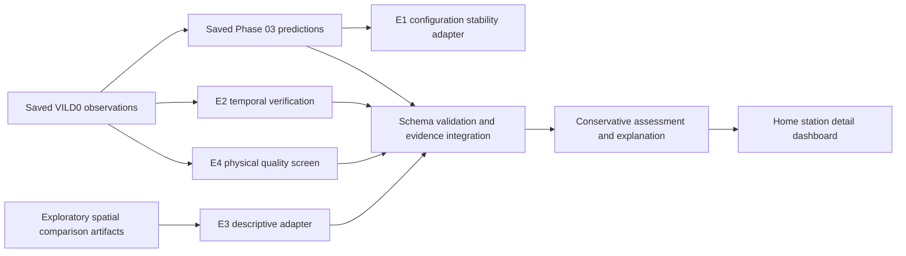

# WeatherGuard E1–E4 Evidence Integration

## Scope and research boundary

The integration layer standardizes and displays existing WeatherGuard evidence for an exact saved observation. It is a conservative evidence orchestrator, **not a validated combined classifier**. It does not refit the historical model, change its labels, or claim that evidence improves accuracy. The governing interpretation remains **ANOMALY ≠ FAULT**.

The app's historical demonstration uses the verified VILD0 processed series and its saved Phase 03 12-configuration prediction grid. The repository has no fitted historical estimator to load, so the Home assessment reads the original saved predictions; it does not rerun model fitting for each selected timestamp. A new uploaded CSV can still invoke the project's existing explicit local model-training flow separately.

## Architecture



The editable Mermaid source is [`docs/weatherguard_e1_e4_architecture.mmd`](docs/weatherguard_e1_e4_architecture.mmd), with a standalone SVG at [`docs/weatherguard_e1_e4_architecture.svg`](docs/weatherguard_e1_e4_architecture.svg).

## Component definitions and integration behavior

Every component record contains an ID and name, execution status, evidence result and label, explanation, timestamp, source metadata, a `reliability` field set to `null` because no calibrated reliability estimate is supported, limitations, and a `decision_eligible` flag.

| Component | Existing implementation used | Evidence shown | Current boundary |
|---|---|---|---|
| E1 — Model stability | Saved `model_predictions.csv` labels, with the established 8/12 screen | Vote count and exact saved configuration rows | Eligible only to emit the existing candidate/review signal. Agreement is not probability, event truth, or a fault diagnosis. Incomplete grids are insufficient data. |
| E2 — Temporal consistency | `services/temporal_service.py`, real-time mode | Prior-only local departure or repeated-value screen and its reason | Thresholds are screening defaults, not validated fault rules. A temporal flag does not establish regional weather. |
| E3 — Spatial corroboration | Existing Phase 03 `spatial_comparison_*.csv`, when a row indexed to the selected candidate time exists | Descriptive rows only, including recorded neighbor time offsets; otherwise insufficient independent data | Candidate-time indexing does not establish exact neighbor-time alignment. Phase 09 was descriptive only; Phases 10–11 found insufficient independent data. Sensor/operator provenance and event adjudication remain unresolved. E3 is always decision-ineligible. |
| E4 — Physical plausibility | `weather_research.quality.physical_quality_flags` | Broad range and cross-variable screening flags; missing values remain visible | Rules are not calibration limits or hardware diagnoses. Missing values are never treated as normal evidence. |

The common execution statuses are `AVAILABLE`, `UNAVAILABLE`, `DESCRIPTIVE_ONLY`, `INSUFFICIENT_DATA`, `ERROR`, and `NOT_APPLICABLE`. An evidence result is separate from execution status, so a completed screen with no detected evidence is not confused with a missing component.

## Integration and final assessment

`services/evidence_integration.py` runs each adapter independently and captures failures as `ERROR` records. It validates each result against the common schema, preserves the baseline prediction rows, and lists supporting screens, contradictory screens, restricted descriptive evidence, and unavailable evidence separately. It does not vote, apply component weights, assume independence, or let E3 alter an assessment.

The current conservative triage policy uses only the existing saved 8/12 baseline candidate screen, represented by E1:

- `SUSPICIOUS`: the complete saved 12-configuration grid meets its existing 8/12 candidate screen. This is a request to review the reading, not a verified anomaly or sensor fault.
- `INSUFFICIENT_EVIDENCE`: no complete saved baseline exists, or the baseline does not meet the candidate screen while independent event validation and a validated combined rule remain unavailable.
- `NORMAL` and `ANOMALOUS` are supported output categories in the schema but are not currently emitted. Available evidence does not validate either conclusion at event level.

The final result includes `is_validated_combined_classifier: false` and a plain-language reason. No confidence or component-reliability score is invented.

## Dashboard

The Home station details expander shows the saved baseline vote summary and each E1–E4 status, result label, explanation, source, and limitation. Component details can be expanded. Selecting a neighboring station marks primary-series E1/E2/E4 as not applicable; neighbor records are context and are not treated as validated corroboration.

## Known limitations

- Baseline predictions are historical saved outputs; an interactive assessment does not refit the model.
- The E3 files are exploratory and do not establish independent observations, sensor lineage, or event truth.
- E2 and E4 screens can describe data behavior or broad physical inconsistencies; neither identifies hardware failure.
- The final triage is deliberately conservative and has not been calibrated against independent fault/event labels.
- The Home map's station record coordinates are not confirmed sensor locations.
- A result at one timestamp is not a station-wide diagnosis.

## Run

From the repository root:

```powershell
python -m streamlit run app.py
```

Run the integration tests:

```powershell
python -m unittest tests.test_evidence_integration
```
