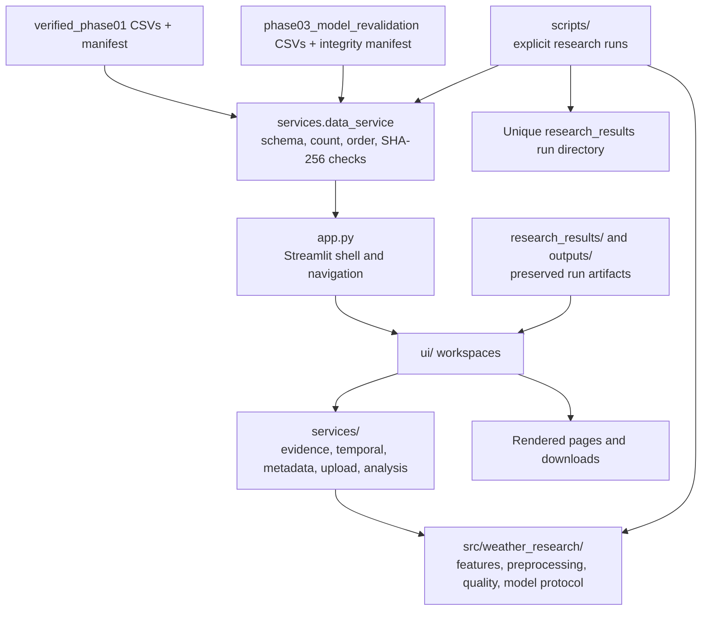

# WeatherGuard AI Architecture

## Scope

WeatherGuard AI is a local research application that presents an existing historical snapshot, saved model outputs and evidence analyses. It is not a production ingestion service, operational alert pipeline or validated fault classifier. Its evidence policy preserves **ANOMALY ≠ FAULT**.

## Component map

## Data loading and integrity boundary

`services.data_service.load_project_data(root)` loads the primary tables and checks declared hashes, row counts and ordered columns for selected Phase 01 files, then verifies the Phase 03 artifact set against its manifest. The Phase 03 manifest itself labels its audit as `HASHED_INTEGRITY_ONLY_HISTORICAL_PROVENANCE_UNKNOWN`. Therefore successful loading means the local files match declared integrity metadata; it does **not** establish original source, acquisition history, station identity or independent sensor lineage.

The main snapshot contains 44,879 rows in `model_df.csv`, of which 44,849 are represented in feature-ready matrices. `X_train_multi.csv` contains 36,434 rows and `X_test_multi.csv` 8,415 rows. The train segment ends 2025-03-14 23:30+05:30; the test begins 2025-03-21 23:30+05:30. A seven-day temporal separation is preserved. Exact manifest details and caveats are in [Reproducibility](REPRODUCIBILITY.md).

## Application and services

`app.py` builds the navigation shell, obtains loaded project data and dispatches to seven workspaces: Home, Weather Data, Investigate a Reading, Model Evaluation, Experiment Lab, Research and About. UI modules under `ui/` render historical plots, maps, tables, evidence explanations and saved research artifacts.

Service responsibilities include loading and validating saved artifacts (`services/data_service.py`), producing evidence assessments (`services/evidence_integration.py`), temporal context (`services/temporal_service.py`), model protocol and optional explicit refits (`services/model_service.py`), station metadata and descriptive comparison context, and uploaded-data analysis. Core feature construction, preprocessing and physical screening live in `src/weather_research/`.

E1–E4 are displayed as separate evidence components:

- **E1 — model stability:** agreement across configured detector outputs. The outputs share model/data dependencies; this is not independent corroboration or a calibrated probability.
- **E2 — temporal consistency:** comparison with prior context, with retrospective modes potentially using future context. It is contextual evidence, not an independent fault label.
- **E3 — spatial corroboration:** neighbor comparisons are descriptive-only or unavailable under current lineage/coverage rules. Current local research outputs have zero decision-eligible independent station evidence. E3 is isolated and is not a classifier vote.
- **E4 — physical plausibility:** range and cross-variable screening. Zero flags do not prove sensor calibration or station health; missing evidence is not a normal result.

The integrated policy can mark a baseline candidate as `SUSPICIOUS`; otherwise it retains `INSUFFICIENT_EVIDENCE`. It does not claim `NORMAL` or `ANOMALOUS` as a validated ground-truth classification. An anomaly candidate is not a fault determination.

## Models and saved results

The saved protocol uses Isolation Forest, Local Outlier Factor in novelty mode and One-Class SVM over 12 documented configurations. LOF and One-Class SVM use a `StandardScaler` fit on training data only. The application does not fit models merely by opening Model Evaluation; a refit is initiated through an explicit control. Saved prediction files are historical artifacts and are not silently replaced by the UI.

Research scripts can create output under unique `research_results/` run directories. The E1–E4 ablation script operates on saved held-out outputs; synthetic campaign scripts intentionally fit or inject synthetic values as described in their reports. Preserve each run and its manifest. The documented mismatch of 42 out of 100,980 prediction cells remains unresolved and prevents a claim of exact local refit reproduction.

## Failure and missing-data handling

Loading errors are surfaced if required files or integrity metadata are absent or inconsistent. Evidence components preserve statuses such as unavailable, insufficient data and descriptive-only rather than coercing missing values into agreement. E3 coverage absence is reported separately from contradictory evidence. Uploaded-data analyses are distinct from the preserved historical research protocol and must not be merged into its claims without a defined protocol.

## Key source locations

- Application shell: `app.py`
- User interface: `ui/`
- Data and evidence services: `services/`
- Research algorithms: `src/weather_research/`
- Snapshot and manifests: `verified_phase01/`, `phase03_model_revalidation/`
- Saved study outputs: `research_results/`, `outputs/`
- Automated checks: `tests/`, `.github/workflows/research-quality.yml`
