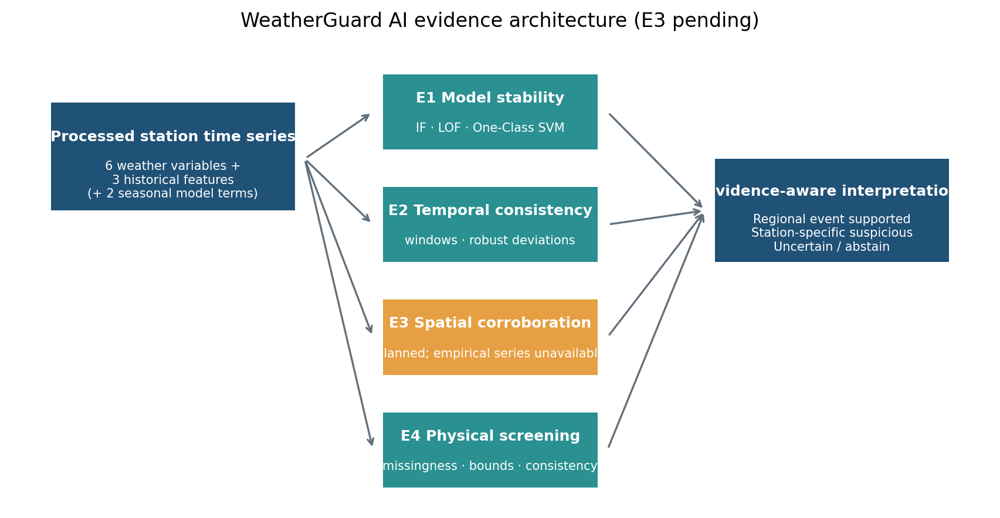
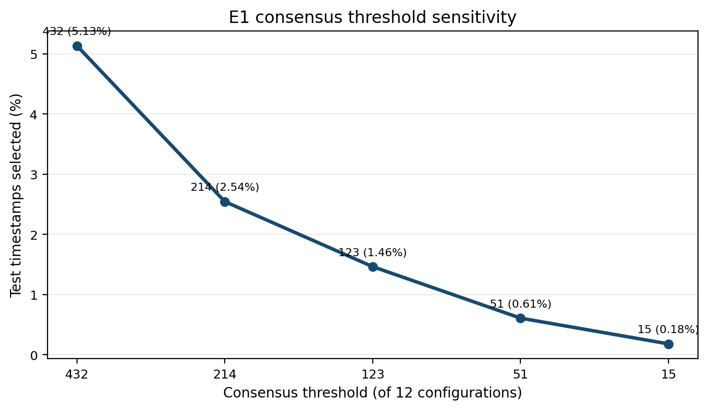
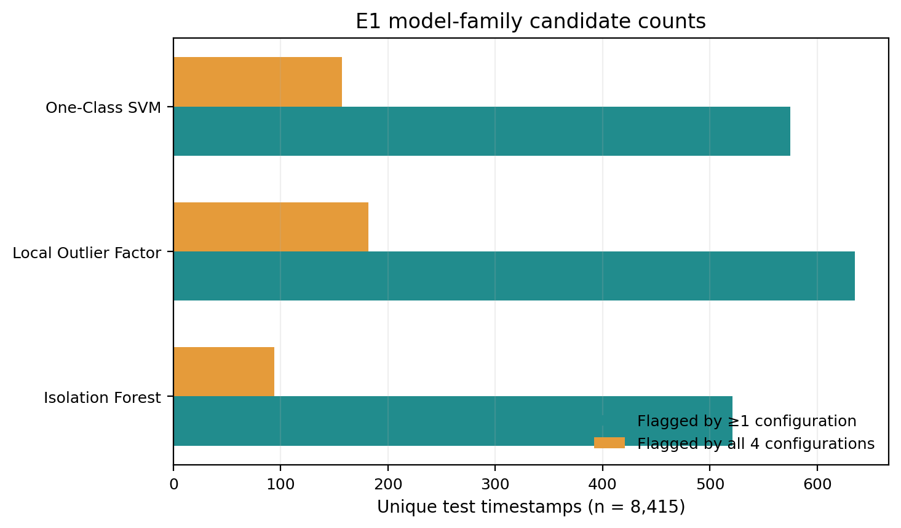
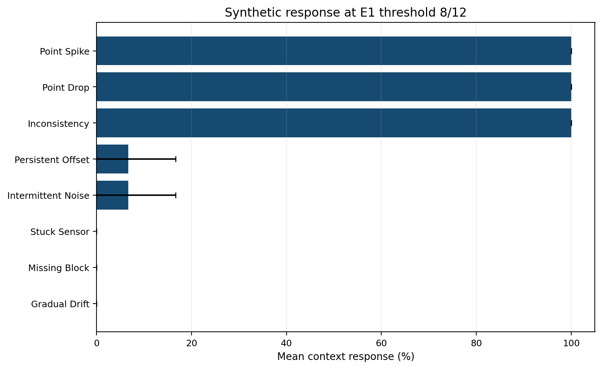
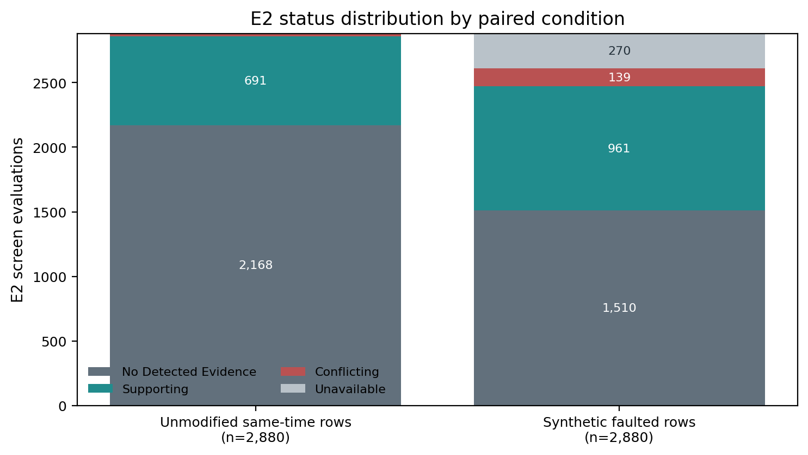
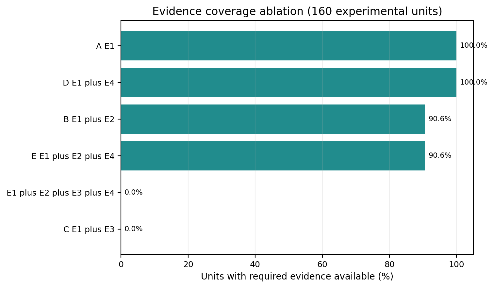

# WeatherGuard AI: Uncertainty-Aware Event-Level Verification of Weather Station Anomalies Using Model Stability, Temporal Consistency and Spatial Evidence\n\n## Preliminary Research and Experimental Evaluation Report\n\n| Report detail | Value |\n|---|---|\n| Research title | Uncertainty-Aware Event-Level Verification of Weather Station Anomalies Using Model Stability, Temporal Consistency and Spatial Evidence |\n| Report status | Preliminary research and experimental evaluation |\n| Source checkpoint | `codex/phase1c-controlled-metar-pilot` at `07edecdad90c36b98c0e2ad789f4d5c07bed728e` |\n| Report date | 18 November 2026 |\n\n> This is a preliminary research and experimental evaluation report. It documents a functioning prototype and controlled synthetic studies. Real-world spatial corroboration and independent field validation remain future work.\n\n## Abstract\n\nWeather station anomalies can arise from unusual atmospheric conditions, measurement faults, or both. This report evaluates WeatherGuard AI, a research prototype that combines unsupervised model stability (E1), temporal consistency screening (E2), planned neighbouring-station corroboration (E3), and physical measurement screening (E4). The study audits saved historical and synthetic artifacts without fitting new models or retrieving additional observations. The processed snapshot contains 44,879 rows, of which 44,849 are feature-ready; 36,434 observations form the chronological training partition and 8,415 the test partition, separated by seven days. Twelve configurations from Isolation Forest, Local Outlier Factor and One-Class SVM generate a saved grid of 100,980 predictions. Consensus threshold counts decline from 432 timestamps at 4/12 agreement to 15 at 12/12. Reviewed E2 outputs contain 6,840 screen evaluations and 2,880 paired setting-level rows representing 160 underlying pair IDs repeated across 18 settings. A temporal `SUPPORTING` status indicates departure from a selected history screen, not a confirmed fault. Corrected synthetic baseline summaries cover 160 context-by-scenario-by-injected-timestamp units across five preselected contexts and eight perturbations. Response varies materially by scenario and context. A coverage ablation reports evidence availability only and cannot establish outcome-level utility. The planned E3 comparison was blocked: the investigated METAR adapter did not cover the proposed September 2025 period, and no observation rows were retrieved. Forty-two Isolation Forest prediction mismatches also remain unexplained. The results support an uncertainty-aware research direction and demonstrate selected prototype behaviors, but there are no independently adjudicated field fault or clean labels. Consequently, real-world accuracy, calibration and operational benefit cannot yet be claimed.\n\n**Keywords:** weather station quality control; anomaly detection; sensor fault screening; temporal consistency; spatial corroboration; uncertainty; abstention; synthetic evaluation\n\n## Contents\n\n1. Introduction\n2. Research Problem and Objectives\n3. Literature Review\n4. Dataset and Preprocessing\n5. Proposed Methodology\n6. Experimental Design\n7. Results\n8. System Implementation\n9. Discussion\n10. Limitations\n11. Future Work\n12. Conclusion\nReferences\nAppendices and Reproducibility Information\n\n## Figures\n\n1. WeatherGuard AI evidence architecture and E1–E4 framework\n2. E1 consensus threshold sensitivity\n3. E1 model-family candidate counts\n4. Corrected five-context synthetic scenario response\n5. E2 status distribution by paired condition\n6. Evidence availability ablation\n\n## Tables\n\n1. Snapshot and chronological split\n2. E1 consensus counts\n3. E1 family-level candidates\n4. Corrected context response at 8/12 E1 consensus\n5. E2 paired status counts\n6. Evidence availability ablation\n7. Evidence status by research phase\n\n## Abbreviations\n\n- **E1–E4:** Model stability, temporal consistency, spatial corroboration, and physical screening evidence groups.\n- **IF:** Isolation Forest.\n- **LOF:** Local Outlier Factor.\n- **OCSVM:** One-Class Support Vector Machine.\n- **METAR:** Aviation routine weather report.\n- **RH:** Relative humidity.\n- **UTC:** Coordinated Universal Time.\n- **QA/QC:** Quality assurance / quality control.\n- **Abstention:** An uncertain/insufficient-evidence outcome rather than a forced classification.\n\n# 1. Introduction\n\n## 1.1 Context and problem\n\nAutomatic weather stations support monitoring, forecasting, climate analysis and operational decisions. Their readings can be unusual because the atmosphere is unusual, because a sensor or communication path has failed, or because both processes act together. A statistical outlier is therefore not equivalent to a faulty instrument. Meteorological quality-control practice combines temporal checks, physical constraints, spatial comparisons and expert review; individual automated flags are evidence for review rather than final diagnoses [1], [2].\n\nUnsupervised anomaly detectors can rank observations that differ from a learned distribution, but their outputs depend on the training sample, representation, configuration and seasonal context. Temporal screening can establish that a reading departs from a station's recent history, but a rapid weather transition can also do so. Physical bounds and cross-variable checks can expose implausible values, yet broad limits may miss subtle faults and can flag valid extremes if poorly localized. Neighboring stations can help distinguish a regional event from a station-specific departure, but only when station identity, temporal overlap, data provenance and spatial representativeness are established.\n\n# 2. Research Problem and Objectives\n\n## 2.1 Research question and objectives\n\nThe central question is: **Can model stability, temporal consistency, neighbouring-station observations and physical sensor-quality screening help distinguish unusual regional weather events from suspicious station-specific observations when independently labelled fault data are limited?**\n\nThe objectives are to: (1) audit a saved historical anomaly analysis; (2) characterize agreement among three unsupervised model families; (3) review temporal and physical screening behavior under controlled synthetic perturbations; (4) define an evidence-aware interpretation that can abstain when evidence is missing or conflicting; and (5) identify the data and validation required before field performance can be assessed.\n\n## 2.2 Scope and proposed contribution\n\nThe work combines a processed historical snapshot with saved model predictions, synthetic fault experiments, software checks and station/provider metadata review. It does not reconstruct the raw observation source, acquire additional data or fit new models. The proposed contribution is a structured research framework for displaying multiple evidence streams and explicitly representing uncertainty. This is a design and evaluation direction, not a claim of algorithmic novelty or validated integrated performance.\n\nThe intended interpretation categories are: (i) regionally supported unusual event; (ii) station-specific suspicious observation; and (iii) uncertain or insufficient evidence. The categories are proposed targets. Independent field labels and empirical spatial evidence are not available to validate them.\n\n# 3. Literature Review\n\n## 3.1 Meteorological quality control\n\nOperational and research QA/QC systems generally use a sequence of checks because no single threshold is sufficient for all variables, climates and station designs. Fiebrich et al. describe mesoscale data quality procedures spanning automated checks and human review [1]. Guidance for automatic weather stations emphasizes validation procedure design, sensor characteristics and local conditions [2]. Network standardization work also highlights station metadata, spatial representativeness and consistent temporal and spatial tests [3]. These findings motivate WeatherGuard AI's separation of model, temporal, spatial and physical evidence.\n\nRecent QA/QC research continues to emphasize staged workflows and the difficulty of separating genuine environmental extremes from faulty measurements [4]. Sensor-quality modeling has also explored explicit uncertainty or certainty representations [5]. Such approaches are relevant as methodological context, but WeatherGuard AI does not reproduce their specific algorithms. Here, the primary concern is to avoid converting an automated flag into a fault assertion when reference evidence is missing.\n\n## 3.2 Time-series anomaly detection\n\nAnomaly-detection surveys distinguish point, contextual and collective anomalies and describe the dependence of methods on data assumptions and task definitions [6], [7]. Weather measurements have seasonality, serial dependence, irregular missingness and physical interactions. Accordingly, an unsupervised score should be interpreted relative to a declared representation and reference period rather than as a universal fault probability.\n\nThe project evaluates Isolation Forest [8], Local Outlier Factor [9] and One-Class SVM [10]. They represent different notions of unusualness: isolation depth, local density and support of a learned distribution. Agreement across configurations can be informative about model sensitivity, but the configurations share data and are not independent judges. A vote fraction is not a calibrated posterior probability and does not supply a reference-label accuracy estimate.\n\n## 3.3 Evidence fusion and research gap\n\nTemporal and physical rules can complement distributional models, while spatial corroboration can provide event context. However, their errors and missingness differ. A regional extreme may be anomalous to a model but supported nearby; a sensor fault may be temporally persistent yet remain physically plausible; a source gap may make neighboring evidence unavailable. Thus, a useful system must represent support, conflict and unavailability explicitly and allow abstention.\n\nThe project-specific gap is narrow: how to organize unsupervised model stability with temporal, spatial and physical evidence when real fault labels are absent and some evidence is unavailable. The repository contains partial software and controlled studies for E1, E2 and E4. The E3 data acquisition and independent outcome references remain blocked. The current report therefore establishes prototype status and experimental behavior, not a validated integrated decision rule.\n\n## 3.4 Literature review method\n\nThis is a focused narrative review of verified methodological sources, not a systematic literature review. The cited works were selected for meteorological data quality control, sensor data validation and general time-series anomaly detection. Search coverage, screening and inclusion were not protocolized exhaustively; conclusions about the state of the art or novelty are intentionally limited.\n\n# 4. Dataset and Preprocessing\n\n## 4.1 Processed historical snapshot\n\nThe repository stores a processed station time series in `verified_phase01/model_df.csv`; the report treats it as a processed historical snapshot, not raw acquisition. It contains 44,879 rows. Feature-ready input `X_multi.csv` contains 44,849 rows; the difference is consistent with rows excluded because historical lag/rolling features could not be formed. The main meteorological variables are air temperature, dew point, relative humidity, precipitation, wind speed and pressure. The saved base matrix contains those six variables and three temperature-history terms. The model service constructs two cyclical month terms (`month_sin`, `month_cos`) at runtime, so the model protocol uses 11 predictors. The timestamp column is an index, not a predictor.\n\nThe processed time span is approximately 5 January 2021 through 9 March 2026 in the recorded Asia/Kolkata timezone. The source snapshots contain 71 missing cells in `model_df.csv`, including six missing precipitation values; the saved feature matrix has no missing values. The integrity audit documents training-median imputation for retained missing precipitation values. Three historical temperature features are previous-row temperature change, a prior six-observation rolling mean and deviation from that prior mean, computed within segment boundaries. “Six observations” is not necessarily six elapsed hours across every gap; the sequence is segmented to avoid carrying features across discontinuities.\n\n## 4.2 Chronological partition and model preprocessing\n\nThe stored training partition has 36,434 observations and the test partition has 8,415. The test period begins seven days after the last training timestamp. The temporal separation is intended to reduce immediate boundary leakage; it does not establish statistical independence, eliminate seasonal distribution shift, or provide a labeled test set. The saved feature snapshots are chronological and non-overlapping.\n\nThe saved model service adds cyclical month terms from timestamps. The scaler is fitted on training data only for LOF and OCSVM; Isolation Forest uses the unscaled feature matrix in the saved protocol. Training-only median handling is described in the preprocessing audit. Because archived estimator/scaler objects and complete historical fit provenance are unavailable, the report does not claim an independent end-to-end reconstruction of every historical prediction.\n\n## 4.3 Data integrity and provenance\n\nPhase 01 manifests contain hashes and counts for the saved data artifacts. The local integrity audit compares historical engineered features with their defining formulas, checks split membership and verifies imputation consistency. A hash verifies that a file matches the manifest; it does not prove that the original measurements are traceable to a particular physical instrument or that an experiment is scientifically valid. The raw source, retrieval request and row-level source indicators are not independently reconstructed here.\n\n**Table 1. Snapshot and chronological split.**\n\n| Artifact | Rows | Role |\n|---|---:|---|\n| `model_df.csv` | 44,879 | Processed snapshot with timestamps and engineered fields |\n| `X_multi.csv` | 44,849 | Feature-ready historical matrix; nine stored predictors |\n| `X_train_multi.csv` | 36,434 | Chronological training partition |\n| `X_test_multi.csv` | 8,415 | Chronological test partition |\n| `model_predictions.csv` | 100,980 | Saved configuration-by-test-time prediction records |\n\n## 4.4 Station acquisition readiness and E3 status\n\nPhase 1A reviewed five station/provider identities and assessed four neighboring candidates using inventory and metadata. Individual observation availability for the seven assessed parameters remained unchecked; no observations were downloaded. Phase 1B inventoried 179 provider/parameter metadata records for VILD0, 42099, 42101, 42105 and 42096. VILD0 and 42099 remain identity-unresolved; 42105 is a conditional regional candidate; 42101 is a conditional alternative; 42096 was excluded from the proposed hourly period. Inventory envelopes do not establish actual timestamp coverage, direct observations or common data.\n\nPhase 1C inspected Meteostat Python 2.2.3's hourly interface and METAR provider adapter for VILD0 and 42105, five requested parameters (`temp`, `rhum`, `wspd`, `wdir`, `pres`), and a proposed 1–30 September 2025 window. The inspected adapter's METAR registry began on 16 November 2026 and its Aviation Weather Center query used a 24-hour window. The proposed historical period was therefore unavailable through this adapter. No observation call was made and no real E3 comparison was completed. The documented implementation derives relative humidity from temperature and dew point; source labels would not establish instrument-level provenance, and row-level indicators were not retrieved. Phase 1C status is `PILOT_WORKFLOW_BLOCKED_PROVIDER_INTERFACE_UNVERIFIED`.\n\n# 5. Proposed Methodology\n\n## 5.1 Evidence framework\n\nWeatherGuard AI organizes evidence into four streams. Figure 1 shows the intended flow. The integrated interpretation is partially implemented scaffolding and is not independently validated.\n\n\n\n**Source:** `app.py`, `src/weather_research/evidence.py`, `src/weather_research/quality.py` and the Phase 1C acquisition report. The diagram distinguishes available components from pending spatial observations; it does not report model performance.\n\n\n### Isolation Forest\n\nIsolation Forest identifies observations that can be isolated from the feature sample by relatively short paths through random partitions [8]. It contributes one unsupervised view of unusualness. Its binary saved flags are not estimates of sensor-failure probability.\n\n### Local Outlier Factor\n\nLOF compares an observation's local density with the density of its neighbors [9]. The neighborhood size and feature scaling affect which observations appear locally sparse. The project evaluates four neighborhood settings and interprets their outputs as configuration-sensitive candidates.\n\n### One-Class SVM\n\nOne-Class SVM estimates a boundary around the training distribution and flags observations outside the estimated support [10]. Its `nu` parameter influences the boundary and expected outlier fraction. In the saved project protocol, this family uses training-fitted scaling; incomplete archived fit provenance limits exact historical reproduction.\n\n### E1: model stability\n\nFour settings from each of Isolation Forest, LOF and OCSVM produce 12 model configurations. A configuration predicts either normal or anomalous status at each test timestamp. At a chosen threshold, the system selects timestamps flagged by at least that many configurations. The vote is an agreement measure over these saved configurations. It is not a probability, fault confidence or field-validation statistic.\n\n### E2: temporal consistency\n\nTemporal screens compare a current reading with a prior history window using robust deviations and continuity checks. The reviewed synthetic study includes real-time and retrospective modes, 3-, 6- and 12-hour windows, and robust-z cutoffs of 2.5, 3.5 and 4.5. Statuses are `SUPPORTING`, `CONFLICTING`, `NO_DETECTED_EVIDENCE` and `UNAVAILABLE`. A `SUPPORTING` status means a temporal departure under that screen setting; it does not mean the station is faulty. Missing histories, segment boundaries and injected missing blocks can make the screen unavailable.\n\n### E3: spatial corroboration\n\nThe intended E3 stream compares time-aligned station observations to assess whether an unusual reading is supported in the surrounding region. A valid comparison requires resolved station identity, comparable variables and units, trustworthy observation provenance, shared timestamps, suitable distance/elevation/terrain context and an explicit missing-evidence policy. None of those empirical conditions was completed for this report. E3 is unavailable, not negative.\n\n### E4: physical measurement screening\n\nImplemented checks flag missing, nonnumeric or infinite values, broad variable-specific screening bounds and cross-variable inconsistencies such as dew point above air temperature. Bounds in code are intentionally broad: temperature -90 to 60 °C, dew point -100 to 45 °C, RH 0 to 100%, precipitation 0 to 1000, wind speed 0 to 150, and pressure 800 to 1100 in their recorded units. These checks identify values for review. They are not local climatological validation, calibration, or hardware diagnosis.\n\n## 5.2 Integrated interpretation and abstention\n\nThe target output categories are (1) regionally supported unusual weather event, (2) station-specific suspicious observation, and (3) uncertain or insufficient evidence. Conceptually, the first category requires a model or temporal departure plus trustworthy neighboring support; the second requires a station-local departure with adequate comparison evidence and no stronger regional explanation; the third applies when streams are missing, conflict, or do not meet evidence requirements. The repository contains rule-based scaffolding for these concepts, but E3 is absent and there are no independent reference labels. Consequently, neither category-level performance nor an integrated decision threshold is validated.\n\n\n# 6. Experimental Design\n\n## 6.1 Historical prediction analysis\n\nThe E1 analysis uses 8,415 held-out timestamps and 12 saved configurations. It summarizes configuration-level candidate counts, consensus thresholds and family-level agreement. No independent outcome labels are used, so the experiment measures variation in unsupervised flags rather than accuracy.\n\n## 6.2 Controlled synthetic studies\n\nThe multi-context campaign selects five historical contexts at least 14 days apart and spanning four quarters. Eight perturbation types are applied: a temperature point spike (+10), point drop (-10), persistent offset (+5 over six observations), stuck temperature (six observations), gradual drift (0 to +5 over six observations), missing temperature block (three observations), intermittent noise (standard deviation 2 over six observations), and dew-point increase (+20 over three observations). The campaign combines five contexts and eight scenarios into 40 context-scenario combinations and uses 12 shared model configurations. A shared fit and repeated configurations constrain the inference: the design is controlled and informative about selected perturbations, but is neither a random field sample nor an independent test of fault prevalence.\n\nThe corrected baseline review defines 160 context × scenario × injected-timestamp units. Each unit can contribute multiple configuration decisions. The corrected response summary first computes response within each context and then reports the mean and range across five contexts. This avoids confusing configuration-by-label rows with experimental units. Synthetic response is never reported as field recall, sensitivity or accuracy.\n\n## 6.3 E2 paired synthetic study\n\nE2 compares injected and unmodified readings at the same timestamps, plus matched unmodified controls drawn from 10 preselected controls. The reviewed outputs cover six meteorological variables in unmodified same-time rows and target variables in injected rows. There are 2,880 paired setting-level rows across conditions, modes and settings; they represent 160 underlying pair IDs repeated over 18 settings, not 2,880 independent events. Repeated parameter settings are dependent, and matched controls were not independently adjudicated as clean. A missing-block injection can remove the history needed by a screen, producing `UNAVAILABLE` rather than evidence of a fault.\n\n## 6.4 Baseline comparison and availability ablation\n\nThe corrected baseline compares E1 consensus thresholds, model families, E2 settings and E4 direct-variable screens using the 160-unit base. The E1+E3 and full evidence combinations have no E3 observations. The ablation therefore reports how often required evidence was available, not whether the combinations improve correctness, utility or calibration.\n\n## 6.5 Distinguishing experiment types\n\nThree evidence types are kept separate. **Historical prediction evaluation** summarizes saved unlabeled anomaly outputs. **Synthetic experimentation** applies controlled perturbations to selected historical contexts. **Software regression and integrity tests** check implementation behavior, file schemas and artifact hashes. Software tests support implementation claims only; they do not validate real-world detection. Hash verification supports artifact identity only.\n\n# 7. Results\n\n## 7.1 Dataset and model configuration\n\nCounts verified from stored files match the Phase 01 and Phase 03 manifests: 44,879 processed rows; 44,849 feature-ready rows; 36,434 training rows; 8,415 test rows; 100,980 prediction records; and 8,415 distinct test timestamps. Six precipitation cells are missing in the processed source and are handled in the saved feature workflow using training-only median imputation. The saved feature matrix is complete. The report does not infer instrument provenance from these file properties.\n\n## 7.2 E1 threshold analysis\n\nThe number of candidate timestamps falls as the required agreement threshold increases (Table 2; Figure 2). The 8/12 threshold yields 123 timestamps, or about 1.46% of the test timestamps. This is a screening threshold, not an empirically optimized operating point.\n\n**Table 2. E1 consensus threshold sensitivity. Denominator: 8,415 test timestamps.**\n\n| Agreement threshold | Candidate timestamps | Test timestamps (%) |\n|---:|---:|---:|\n| 4/12 | 432 | 5.13 |\n| 6/12 | 214 | 2.54 |\n| 8/12 | 123 | 1.46 |\n| 10/12 | 51 | 0.61 |\n| 12/12 | 15 | 0.18 |\n\n\n\n**Source:** `research_results/e1_threshold_sensitivity.csv`; evidence claims E1T1–E1T5. This chart shows threshold sensitivity, not an optimized decision boundary.\n\n\nAt family level, LOF has the largest number of timestamps flagged by any of its four configurations (635), followed by OCSVM (575) and Isolation Forest (521). Isolation Forest has 94 timestamps flagged by all four settings, LOF 182 and OCSVM 157. These counts describe configuration sensitivity and overlap, not independent family-level votes or fault truth (Table 3; Figure 3).\n\n**Table 3. Family-level E1 candidate counts. Denominator: 8,415 unique test timestamps per family.**\n\n| Family | Flagged by any configuration | Flagged by all four configurations | Mean configurations voting per timestamp |\n|---|---:|---:|---:|\n| Isolation Forest | 521 | 94 | 0.128 |\n| Local Outlier Factor | 635 | 182 | 0.179 |\n| One-Class SVM | 575 | 157 | 0.165 |\n\n\n\n**Source:** `research_results/e1_family_comparison.csv`; evidence claims E1F1–E1F3. These are saved unlabeled candidate counts, not comparative accuracy.\n\n\n## 7.3 E2 temporal findings\n\nThe reviewed E2 detail contains 6,840 evaluations: 2,880 clean same-time rows, 2,880 synthetic faulted rows, and 1,080 matched-control evaluations. Across 3-hour/6-hour/12-hour windows, two modes and three robust-z thresholds, the saved sensitivity tables show variation in `SUPPORTING` outcomes by setting. This aggregation is descriptive; rows share timestamps and settings, and pooled proportions must not be interpreted as a detection rate against ground truth.\n\nIn the reviewed faulted condition, 961 of 2,610 available comparisons were `SUPPORTING` (36.8%); 270 of the 2,880 faulted evaluations were `UNAVAILABLE`. For clean same-time rows, 691 of 2,880 were `SUPPORTING` (24.0%); for matched controls, 272 of 1,080 were `SUPPORTING` (25.2%). The similar nonzero levels underscore why `SUPPORTING` is not a fault label. Matched controls were not independently adjudicated normal.\n\n\n## 7.4 Five-context synthetic fault campaign\n\nTable 4 reports the corrected mean context response and observed range across five contexts at the 8/12 E1 threshold. The denominator is the injected timestamp units for each scenario; context response fractions are computed before averaging over contexts. Point spike, point drop and dew-point inconsistency each have mean response of 100% at this threshold in the corrected summary. Gradual drift, missing blocks and stuck sensors have mean response of 0%; intermittent noise is 6.7%, and persistent offset 6.7%. Several scenarios have nonzero context maxima despite low mean, showing between-context heterogeneity. The exact scenario values and denominators are registered in the evidence CSV.\n\n**Table 4. Corrected E1 synthetic response at 8/12 consensus. Mean and range are across five contexts; denominator is injected timestamp units across contexts.**\n\n| Scenario | Injected units | Mean response (%) | Context range (%) |\n|---|---:|---:|---:|\n| Dew-point / temperature inconsistency | 15 | 100.0 | 100.0–100.0 |\n| Gradual temperature drift | 30 | 0.0 | 0.0–0.0 |\n| Intermittent temperature noise | 30 | 6.7 | 0.0–16.7 |\n| Missing temperature block | 15 | 0.0 | 0.0–0.0 |\n| Persistent temperature offset | 30 | 6.7 | 0.0–16.7 |\n| Temperature point drop | 5 | 100.0 | 100.0–100.0 |\n| Temperature point spike | 5 | 100.0 | 100.0–100.0 |\n| Stuck temperature sensor | 30 | 0.0 | 0.0–0.0 |\n\n**Interpretation caution:** These are response fractions for injected labels under the corrected saved experiment. They are not recall against real faults, and the small scenario denominators—especially five point-injection units—make generalization inappropriate.\n\n\n\n**Source:** corrected `baseline_review_1/synthetic_baseline_response_summary.csv`, filtered to `E1_consensus` and `8/12`; claims SC01–SC08. Context fractions are computed before their across-context mean and range.\n\n\nThe earlier campaign report also presents configuration × synthetic timestamp fractions. For example, its mean fractions were 0.850 for point spikes, 0.800 for point drops, 0.231 for persistent offsets, 0.081 for stuck sensors, 0.019 for drift, 0.167 for missing blocks, 0.164 for noise and 0.717 for dew-point inconsistency. These are a distinct aggregation level from Table 4; they are not pooled into its context-level results.\n\n## 7.5 Model-family response comparison\n\nThe saved five-context campaign shows model-family differences that depend on perturbation and context. At the earlier campaign's configuration-by-injected-timestamp aggregation, LOF and One-Class SVM each flagged all injected point-drop labels in every context; Isolation Forest averaged 0.40 across contexts. For point spikes, LOF and One-Class SVM each averaged 1.00, while Isolation Forest ranged from 0 to 1.00 by context. For missing-temperature blocks, family mean response fractions were 0.00 for Isolation Forest, 0.50 for LOF and 0.00 for One-Class SVM. These are distinct from the corrected context-level consensus results in Table 4; the two aggregation levels are not combined. Synthetic response fractions are not field recall. The corrected 8/12 consensus response is zero for several gradual, persistent, missing-block and stuck patterns. This does not show that those faults are acceptable or undetectable by all evidence streams; it describes these specific synthetic units and this saved model protocol.\n\n## 7.6 E2 paired comparison\n\nAmong 2,880 paired setting-level rows, status changed after injection in 1,008 (35.0%). The underlying 160 pair IDs recur across 18 settings, so the row proportion is descriptive and not an independent-event estimate. Missing blocks account for an important availability effect: 270 faulted rows became `UNAVAILABLE` because the temporal history was insufficient. In detail, clean same-time evaluations yielded 2,168 `NO_DETECTED_EVIDENCE`, 691 `SUPPORTING`, and 21 `CONFLICTING`. Faulted evaluations yielded 1,510 `NO_DETECTED_EVIDENCE`, 961 `SUPPORTING`, 270 `UNAVAILABLE`, and 139 `CONFLICTING`. These status totals cover evaluations under repeated settings, not unique events.\n\n**Table 5. E2 status counts by condition. Each condition contains 2,880 setting-level evaluations.**\n\n| Condition | No detected evidence | Supporting | Conflicting | Unavailable |\n|---|---:|---:|---:|---:|\n| Same-time unmodified readings | 2,168 | 691 | 21 | 0 |\n| Synthetic faulted readings | 1,510 | 961 | 139 | 270 |\n\nThe 10 matched controls are a separate subset with 272 `SUPPORTING`, 792 `NO_DETECTED_EVIDENCE` and 16 `CONFLICTING` outcomes across 1,080 evaluations. They are not independently verified clean observations.\n\n\n\n**Source:** reviewed `e2_multicontext_fault_detail.csv`, grouped by condition and status. Rows repeat 160 underlying pair IDs across 18 settings; SUPPORTING is not a fault diagnosis.\n\n\n## 7.7 E4 screening findings\n\nThe E4 checks cover missingness, nonnumeric and non-finite readings, broad physical ranges and cross-variable plausibility. In the corrected direct-screen experiment, the missing-temperature-block scenario was flagged across its injected units; the other selected injections received zero E4 direct-screen response in that comparison. This expected result demonstrates that missingness rules can expose a missing block. It does not establish hardware diagnosis, general sensor-fault coverage or suitability of every physical threshold.\n\n\n## 7.8 Synthetic baseline analysis\n\nThe corrected comparison aggregates 160 experimental units (unique context × scenario × injected timestamp), five contexts and eight scenarios. It evaluates E1 thresholds, model families, E2 settings and E4 checks. Table 4 shows the corrected E1 8/12 result; the baseline artifacts retain the other settings. Aggregation must remain explicit: the context mean/range is not interchangeable with the earlier configuration × label response statistic.\n\n## 7.9 Evidence availability ablation\n\nThe availability comparison (Table 6; Figure 6) shows that E1 alone and E1+E4 have all 160 units available; adding E2 yields 145/160 (90.6%). E1+E3 and the full E1+E2+E3+E4 combination have 0/160 complete units because the E3 stream was unavailable. E1+E2+E4 also has 145/160. These results quantify coverage constraints only. They cannot show that a complete evidence set would improve decision accuracy.\n\n**Table 5. Evidence combination coverage. Denominator: 160 context × scenario × injected-timestamp units.**\n\n| Evidence combination | Complete units | Coverage |\n|---|---:|---:|\n| E1 | 160/160 | 100.0% |\n| E1 + E2 | 145/160 | 90.6% |\n| E1 + E3 | 0/160 | 0.0% |\n| E1 + E4 | 160/160 | 100.0% |\n| E1 + E2 + E3 + E4 | 0/160 | 0.0% |\n| E1 + E2 + E4 | 145/160 | 90.6% |\n\n\n\n**Source:** corrected `baseline_review_1/evidence_coverage_ablation_summary.csv`; denominator 160 context × scenario × injected-timestamp units. Coverage cannot establish decision accuracy.\n\n\n## 7.10 Prediction parity issue\n\nThe prediction mismatch investigation contains 42 differing cells out of 100,980, all associated with Isolation Forest. The cause remains unexplained because the historical estimator/scaler state and complete fit provenance are unavailable. The saved historical predictions were not replaced. The discrepancy limits claims of exact computational reproduction and should be resolved or bounded in future work.\n\n# 8. System Implementation\n\n## 8.1 Application architecture\n\nWeatherGuard AI is a Streamlit application that loads saved processed data and research artifacts through service modules. The app describes the data as a historical processed snapshot, shows saved candidates, and presents model behavior and research limitations. It is not a live station feed. Main user-facing workspaces are Home, Weather Data, Investigate a Reading, Model Evaluation, Experiment Lab and Research. The user can explore measurements, review candidate timestamps and inspect model explanations or saved experiments.\n\n## 8.2 Services and research modules\n\nRepository modules separate data loading, model and uploaded-data analysis, physical quality screening, evidence interpretation and artifact integrity checks. Research modules support station preflight, provider metadata, controlled synthetic injections, temporal screens, model evaluation and report artifacts. The five-context synthetic campaign is guarded by saved manifests and artifact integrity checks. UI messaging explicitly describes model flags as candidates rather than accuracy measures and labels the project as a prototype with no verified fault labels.\n\n## 8.3 Software verification\n\nThe repository includes unit and integrity tests for data handling, model services, quality rules, evidence status logic, experiment boundaries and artifact manifests. These tests establish expected software behavior for tested cases. They do not establish scientific validity, field performance or complete provider provenance. The report did not execute new tests or campaigns; it audited saved test reports and reviewed artifacts.\n\n## 8.4 Evidence display and uncertainty\n\nThe application structure supports presenting E1 candidates, temporal or physical evidence, provenance and limitations. The three interpretation categories remain research targets rather than validated app outputs. E3 availability and independently adjudicated reference labels are prerequisites for a defensible integrated display.\n\n# 9. Discussion\n\nThe saved E1 analysis shows a clear stability gradient: stronger agreement selects fewer timestamps, while model-family counts differ. It provides a reproducible way to prioritize review and makes threshold dependence visible. Without reference labels, it cannot identify an optimal threshold, estimate fault likelihood or establish a false alarm rate. The 12 configurations also share a common test dataset, so their votes are correlated evidence.\n\nE2 demonstrates that temporal screens can return support, conflict, no detected departure or unavailable statuses across selected settings. It also demonstrates a central ambiguity: a substantial fraction of unmodified same-time rows and matched controls are `SUPPORTING`. Temporal support therefore means unusual history-relative behavior, not faulty hardware. Conversely, `NO_DETECTED_EVIDENCE` does not prove a reading is normal. Missingness can remove the evidence needed for an assessment, and the correct result is unavailable.\n\nSynthetic E1 response varies sharply by perturbation. Strong response to selected point anomalies and dew-point inconsistency coexists with weak response to drift, stuck readings, missing blocks, noise and persistent offsets at the 8/12 threshold. These selected tests expose limits and context dependence, but the injections do not capture the full range of sensor faults, weather transitions, station environments or failure mechanisms.\n\nE4 catches a designed missing block and screens broad physical inconsistencies. It adds a deterministic line of evidence but cannot distinguish a sensor fault from a real extreme without context. Bounds need station- and variable-specific validation and should preserve potentially valid extremes for review.\n\nE3 remains essential to the central question because spatial support is one route to distinguishing regional weather from station-local behavior. The station inventory and adapter investigation did not provide real observation series. Therefore, the report cannot assess whether neighboring stations support any saved anomaly, how distance or terrain affects corroboration, or whether a proposed spatial rule improves classification.\n\nFinally, the coverage ablation indicates that the full evidence combination cannot currently be populated. It does not demonstrate that combining streams improves outcomes. The appropriate present conclusion is that WeatherGuard AI implements useful investigative components and controlled tests, while its integrated interpretation remains a hypothesis awaiting traceable station data and independent outcome references.\n\n# 10. Limitations\n\n\n\nThe processed snapshot lacks independently reconstructed raw-source and instrument provenance. VILD0/42099 identity remains ambiguous; inventory metadata does not verify common populated observations. The METAR adapter could not serve the proposed September 2025 period, and Phase 1C retrieved no rows. E3 is empirically unvalidated.\n\nNo independently adjudicated field faults or verified clean operation labels are available. Real-world precision, recall, false alarm rates, calibration, utility and generalization cannot be computed. E2 supporting statuses are not fault truth, and matched controls are not independently adjudicated clean. Synthetic experiments are limited to eight perturbations, five selected contexts and particular variables/magnitudes. Repeated configurations and settings are dependent.\n\nThe baseline ablation measures evidence availability only; outcome-level ablation remains incomplete. Robustness across stations, seasons, instruments and acquisition providers remains untested. The 42/100,980 Isolation Forest mismatches are unresolved due to missing historical fit objects and provenance. Full Colab verification is not demonstrated. The literature review is narrative rather than systematic. The physical rules are broad screening limits, not diagnoses.\n\n# 11. Future Work\n\n1. Resolve candidate station identity with operator or authoritative station-register evidence.\n2. Identify a traceable historical observation source and retrieve bounded samples only after availability and provenance checks.\n3. Validate timestamps, units, flags, missingness, source attribution and shared coverage before comparing stations.\n4. Independently adjudicate regional events, station faults and acceptable readings, documenting uncertainty and review protocol.\n5. Evaluate E3 with time-aligned stations and characterize representativeness, distance, elevation and missingness.\n6. Complete outcome-level evidence ablation with independent references and explicit abstention costs.\n7. Expand robustness analysis across sites, seasons, variables, perturbation magnitudes and providers.\n8. Resolve or bound the Isolation Forest parity discrepancy and archive estimator/scaler artifacts with fit provenance.\n9. Reevaluate the integrated three-category interpretation only after the reference set and E3 evidence exist.\n\n\n# 12. Conclusion\n\nThis report answers the research question cautiously. The saved studies show that configuration agreement, temporal screening and broad physical checks can organize candidate observations and reveal different patterns under selected synthetic perturbations. The results also show threshold sensitivity, context dependence, temporal false support on unadjudicated controls, unavailable states under missing histories, and weak E1 response to several persistent or gradual perturbations. They do not establish that the evidence streams distinguish real regional weather from real station faults.\n\nWeatherGuard AI has an implemented research prototype, saved historical anomaly analyses, integrity-checked experiments and prepared station-readiness workflows. The five-context synthetic studies were experimentally evaluated and the saved numerical results were audited. Real-world spatial corroboration, independent fault/normal validation and integrated outcome utility remain unvalidated. The blocked METAR pilot retrieved no observations, and the historical prediction parity issue remains open. The next scientific milestone is traceable station data paired with independent adjudication, not a stronger claim from the current unlabeled snapshot.\n\n# 13. References\n\n[1] C. A. Fiebrich, C. R. Morgan, A. G. McCombs, P. K. Hall Jr., and R. A. McPherson, “Quality Assurance Procedures for Mesoscale Meteorological Data,” *Journal of Atmospheric and Oceanic Technology*, vol. 27, no. 10, pp. 1565–1582, 2010, doi: [10.1175/2010JTECHA1433.1](https://doi.org/10.1175/2010JTECHA1433.1).\n\n[2] V. Estévez, P. Gavilán, and J. V. Giráldez, “Guidelines on validation procedures for meteorological data from automatic weather stations,” *Journal of Hydrology*, vol. 402, nos. 1–2, pp. 144–154, 2011, doi: [10.1016/j.jhydrol.2011.02.031](https://doi.org/10.1016/j.jhydrol.2011.02.031).\n\n[3] C. A. Fiebrich et al., “Toward the Standardization of Mesoscale Meteorological Networks,” *Journal of Atmospheric and Oceanic Technology*, vol. 37, no. 11, pp. 2033–2049, 2020, doi: [10.1175/JTECH-D-20-0078.1](https://doi.org/10.1175/JTECH-D-20-0078.1).\n\n[4] B. Faybishenko et al., “Challenging problems of quality assurance and quality control (QA/QC) of sensor data for environmental studies,” *Stochastic Environmental Research and Risk Assessment*, vol. 36, no. 4, pp. 1049–1062, 2022, doi: [10.1007/s00477-021-02106-w](https://doi.org/10.1007/s00477-021-02106-w).\n\n[5] A. Stawowy et al., “The Analysis and Modelling of the Quality of Information Acquired from Weather Station Sensors,” *Remote Sensing*, vol. 13, no. 4, Art. 693, 2021, doi: [10.3390/rs13040693](https://doi.org/10.3390/rs13040693).\n\n[6] G. Blázquez-García, A. Conde, U. Mori, and J. A. Lozano, “A Review on Outlier/Anomaly Detection in Time Series Data,” *ACM Computing Surveys*, vol. 54, no. 3, Art. 56, pp. 1–33, 2021, doi: [10.1145/3444690](https://doi.org/10.1145/3444690).\n\n[7] V. Chandola, A. Banerjee, and V. Kumar, “Anomaly Detection: A Survey,” *ACM Computing Surveys*, vol. 41, no. 3, Art. 15, pp. 1–58, 2009, doi: [10.1145/1541880.1541882](https://doi.org/10.1145/1541880.1541882).\n\n[8] F. T. Liu, K. M. Ting, and Z.-H. Zhou, “Isolation Forest,” in *Proceedings of the 8th IEEE International Conference on Data Mining*, 2008, pp. 413–422, doi: [10.1109/ICDM.2008.17](https://doi.org/10.1109/ICDM.2008.17).\n\n[9] M. M. Breunig, H.-P. Kriegel, R. T. Ng, and J. Sander, “LOF: Identifying Density-Based Local Outliers,” in *Proceedings of the 2000 ACM SIGMOD International Conference on Management of Data*, 2000, pp. 93–104, doi: [10.1145/335191.335388](https://doi.org/10.1145/335191.335388).\n\n[10] B. Schölkopf, J. C. Platt, J. Shawe-Taylor, A. J. Smola, and R. C. Williamson, “Estimating the Support of a High-Dimensional Distribution,” *Neural Computation*, vol. 13, no. 7, pp. 1443–1471, 2001, doi: [10.1162/089976601750264965](https://doi.org/10.1162/089976601750264965).\n\n# 14. Appendices and Reproducibility Information\n\n## Appendix A. Model configurations\n\nThe saved Phase 03 protocol has 12 configurations: four Isolation Forest contamination settings (0.01, 0.02, 0.03, 0.05); four LOF neighborhood settings (10, 20, 30, 50); and four One-Class SVM `nu` settings (0.01, 0.02, 0.03, 0.05). Exact model fit and seed provenance should be read with the Phase 03 manifest; parity is not exact for 42 Isolation Forest cells.\n\n## Appendix B. Synthetic scenario definitions\n\n| Scenario | Target | Perturbation in saved campaign |\n|---|---|---|\n| Point spike | Temperature | +10 for one timestamp |\n| Point drop | Temperature | -10 for one timestamp |\n| Persistent offset | Temperature | +5 across six observations |\n| Stuck sensor | Temperature | Constant reading across six observations |\n| Gradual drift | Temperature | Increase from 0 to +5 across six observations |\n| Missing block | Temperature | Three missing observations |\n| Intermittent noise | Temperature | Noise standard deviation 2 across six observations |\n| Dew-point inconsistency | Dew point | +20 across three observations |\n\n## Appendix C. Data provenance and integrity summary\n\nThe source snapshot and model outputs are local saved artifacts at the Phase 1C checkpoint. The Phase 1A/1B/1C reports document station identity, provider inventory and adapter feasibility. The evidence register records SHA-256 hashes, row filters and interpretation limits for numerical claims. Hash verification is distinct from provenance and label validation.\n\n**Table 7. Evidence status by research phase.**\n\n| Phase | Status in saved checkpoint | Evidence boundary |\n|---|---|---|\n| Phase 0 | Complete locally | Baseline software and artifact verification; no field label validation |\n| Phase 1A | Partial | Station/provider metadata reviewed; observation availability unchecked |\n| Phase 1B | Partial; external access required | Provider/parameter inventory metadata; identity and observation coverage unresolved |\n| Phase 1C | `PILOT_WORKFLOW_BLOCKED_PROVIDER_INTERFACE_UNVERIFIED` | Adapter inspected; requested historical period unsupported; no rows retrieved |\n| Phase 2 | Outstanding | Independent event, fault and normal reference labels not established |\n\n## Appendix D. Software validation summary\n\nThe repository includes software tests and artifact integrity checks. `TESTING_REPORT.md` records 98 passed, 0 failed and 0 skipped for the latest located full-suite run; it also preserves an earlier Phase 0 result of 84 and an older package result of 31. The 140-pass Phase 1C count supplied in the task context was not independently found in this repository checkpoint, so it is not reported as verified. The report did not run new tests or model workflows. Existing tests support software behavior in covered cases; no software test establishes real-world performance. The master notebook contains historical exploratory material; full hosted-notebook execution is not demonstrated.\n\n## Appendix E. Reproducibility instructions\n\nSee `REPRODUCIBILITY_AND_ARTIFACT_REGISTER.md` for the source commit, input artifact locations, report generation boundaries and verified counts. `build_assets.py` recalculates saved-artifact summaries, figures and the evidence register only; it does not fit a model, regenerate a campaign or fetch external weather observations.\n\n