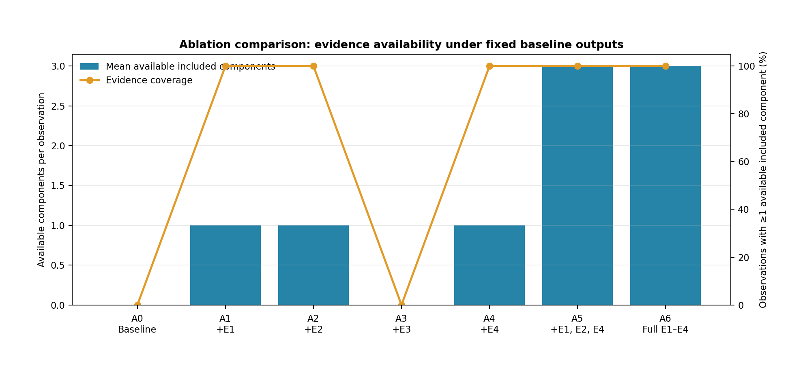
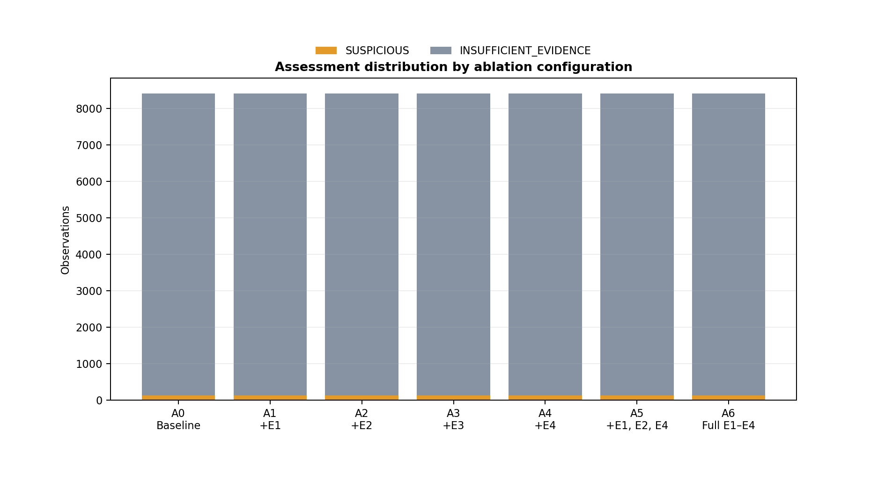
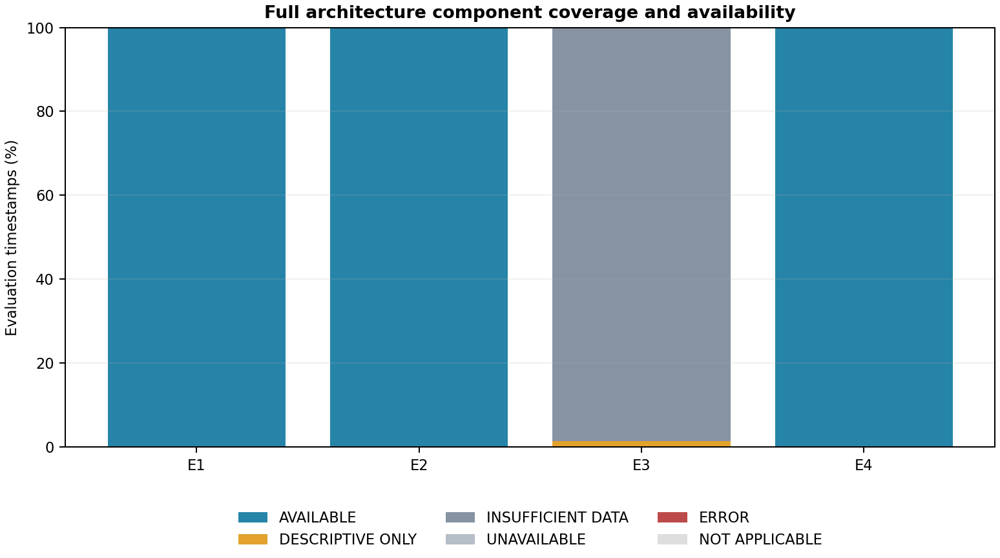
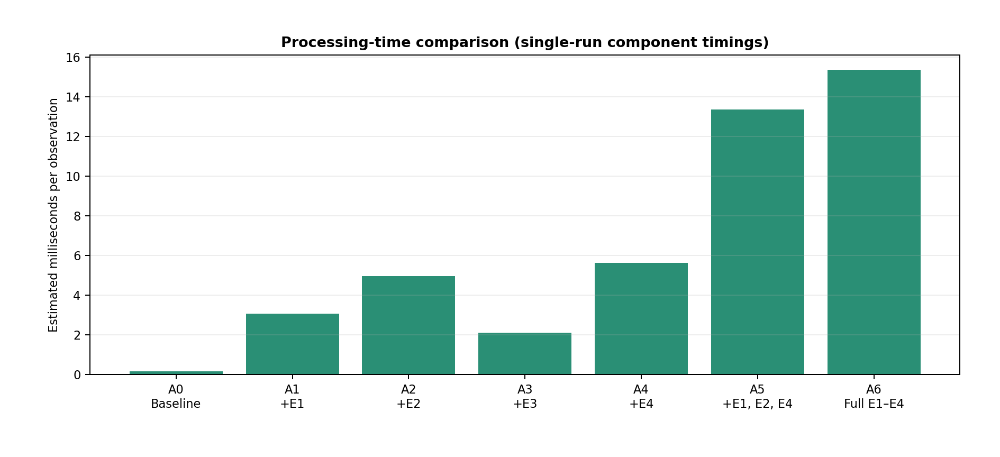
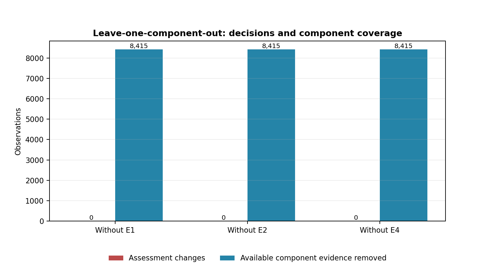
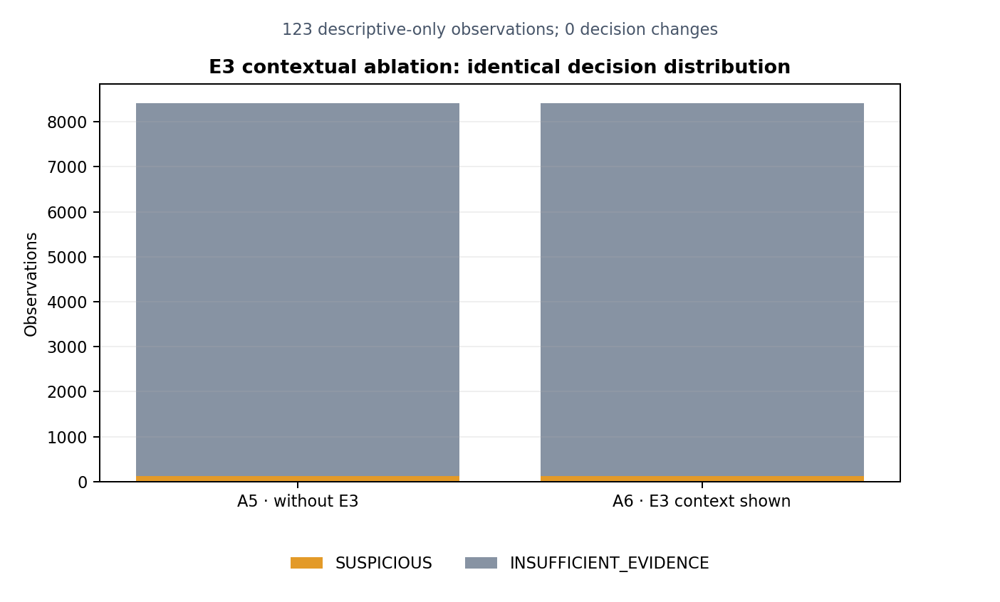

# WeatherGuard E1–E4 Contribution and Ablation Study

**Run:** `e1_e4_ablation_study_20261119T132347Z`  
**Evaluation observations:** 8,415 saved held-out timestamps  
**Period:** 2025-03-21T23:30:00+05:30 to 2026-03-09T23:30:00+05:30  
**Study type:** Structural/operational contribution analysis, not predictive-performance validation.

## Methodology

The same verified processed observations, exact saved Phase 03 baseline prediction grid, 8/12 screen, preprocessing, and held-out timestamp sequence were reused in every configuration. The baseline grid has 12 saved configuration outputs per timestamp. The 36,464 training rows were not assessed because no saved baseline prediction rows exist for them. Evidence coverage is the percentage of observations with at least one included component in `AVAILABLE`; E3 `DESCRIPTIVE_ONLY` context is counted separately and does not count as decision-eligible evidence coverage.

No model was retrained, no external data were downloaded, no thresholds were introduced, and no original research artifact was modified. Components were computed once per observation; configurations were then compared by masking component records. A disabled component is `NOT_APPLICABLE`, never negative evidence.
Processing times are single-run estimates: measured adapter time for included components plus the time to assemble and summarize the ablation result. The seven configurations were not separately cold-start benchmarked; timings are operational comparisons, not performance claims.

## Configuration comparison

| ID | Configuration | SUSPICIOUS | INSUFFICIENT_EVIDENCE | Evidence coverage | E3 context obs. | Conflicts | Execution failures | Mean ms / observation | Assessment changes vs A0 |
|---|---|---:|---:|---:|---:|---:|---:|---:|---:|
| A0 | Baseline only | 123 | 8,292 | 0.00% | 0 | 0 | 0 | 0.1676 | 0 |
| A1 | Baseline + E1 | 123 | 8,292 | 100.00% | 0 | 0 | 0 | 3.0661 | 0 |
| A2 | Baseline + E2 | 123 | 8,292 | 100.00% | 0 | 0 | 0 | 4.9751 | 0 |
| A3 | Baseline + E3 descriptive context | 123 | 8,292 | 0.00% | 123 | 0 | 0 | 2.1226 | 0 |
| A4 | Baseline + E4 | 123 | 8,292 | 100.00% | 0 | 0 | 0 | 5.6452 | 0 |
| A5 | Baseline + E1 + E2 + E4 | 123 | 8,292 | 100.00% | 0 | 0 | 0 | 13.3766 | 0 |
| A6 | Full E1–E4 (E3 descriptive only) | 123 | 8,292 | 100.00% | 123 | 0 | 0 | 15.3554 | 0 |









## Component availability in A6

| Component | AVAILABLE | DESCRIPTIVE_ONLY | INSUFFICIENT_DATA | ERROR | NOT_APPLICABLE |
|---|---:|---:|---:|---:|---:|
| E1 | 8,415 | 0 | 0 | 0 | 0 |
| E2 | 8,415 | 0 | 0 | 0 | 0 |
| E3 | 0 | 123 | 8,292 | 0 | 0 |
| E4 | 8,415 | 0 | 0 | 0 | 0 |

## Leave-one-component-out analysis

The reference is A5 (baseline + E1 + E2 + E4). Baseline predictions remain fixed in every comparison.

| Removed | Assessment changes | Observations with removed component available | Mean available components before → after |
|---|---:|---:|---:|
| E1 | 0 | 8,415 | 3.000 → 2.000 |
| E2 | 0 | 8,415 | 3.000 → 2.000 |
| E4 | 0 | 8,415 | 3.000 → 2.000 |



## E3 contextual ablation

Adding E3 descriptive context changed 0 of 8,415 integrated assessments. E3 descriptive rows were available at 123 timestamps (246 comparison rows total). E3 was decision-eligible in 0 cases.



## Interpretation

The saved baseline candidate output is itself calculated from the 12 model-configuration labels summarized by E1. Under the required baseline-preservation control, A0 and A1 are therefore not independent. Removing the E1 evidence record does not remove the preserved baseline's 8/12 candidate signal. A zero assessment change for E1 is not evidence that E1 has no role; its role is embedded in the baseline definition and cannot be independently identified by this design.

E2 and E4 provide temporal and broad physical screening information. They can change evidence coverage, but do not change categories under the existing conservative integration policy. E3 adds descriptive comparison context where a candidate-time-indexed row exists; it is not used as independent corroboration and does not change categories. A candidate-time match does not establish exact neighbor timestamp alignment; row-level offsets remain visible in the E3 output.

## Research limitations

There are no suitable independently adjudicated event/fault labels, so accuracy, precision, recall, and F1 are unsupported and were not calculated. `SUSPICIOUS` denotes the saved 8/12 model screen for review, not an anomalous weather event or sensor fault. `INSUFFICIENT_EVIDENCE` is not equivalent to normal. E3's independent station lineage, exact alignment, and event adjudication remain unresolved. Processing times are single-run operational estimates and not controlled benchmarks.

Detailed per-observation outputs are in `ablation_results.csv`; the aggregate table is `ablation_configuration_summary.csv`; the assessment-change and E3 detail tables are also provided as CSV. See `ablation_summary.json` for hashes, counts, timing method, and limitations.

## Reproduction

```powershell
python scripts/run_e1_e4_ablation.py --output-dir research_results/e1_e4_ablation_study_20261119T132347Z
```
