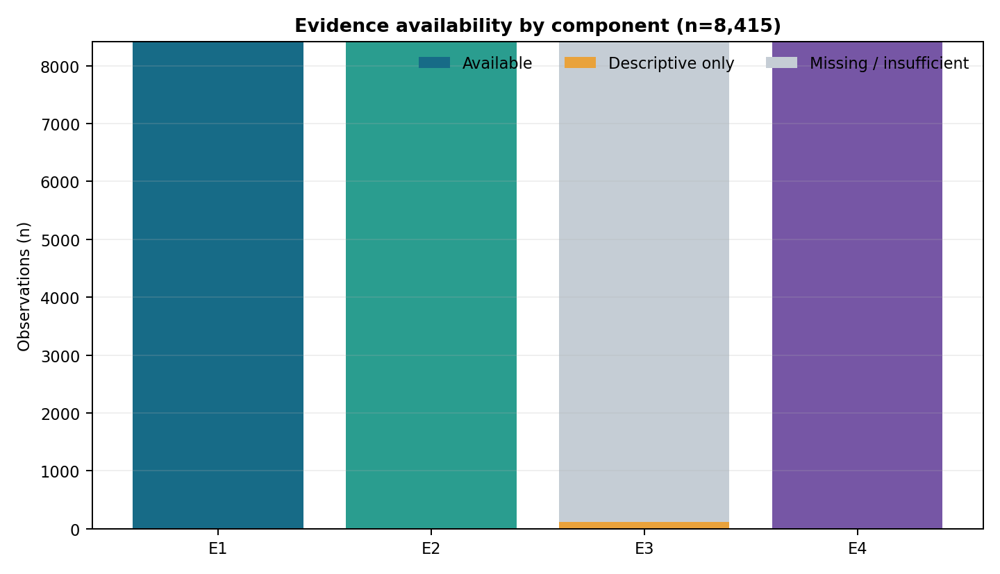
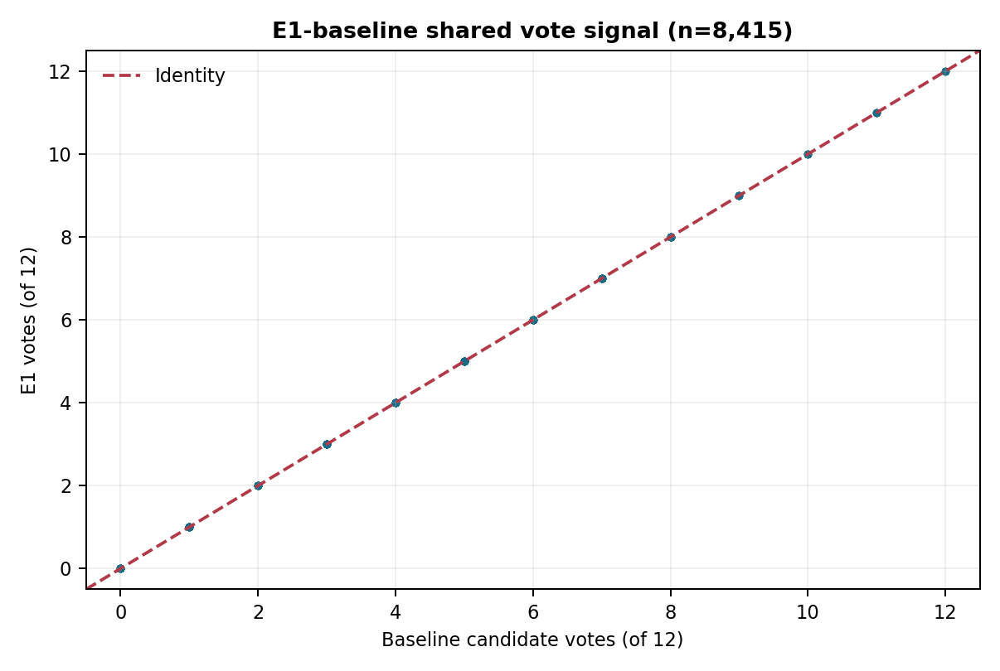
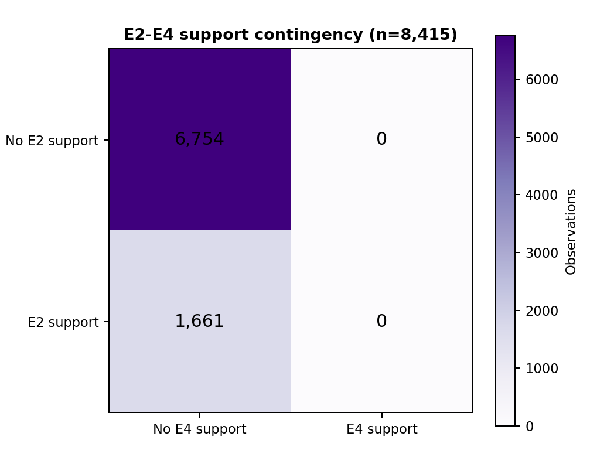
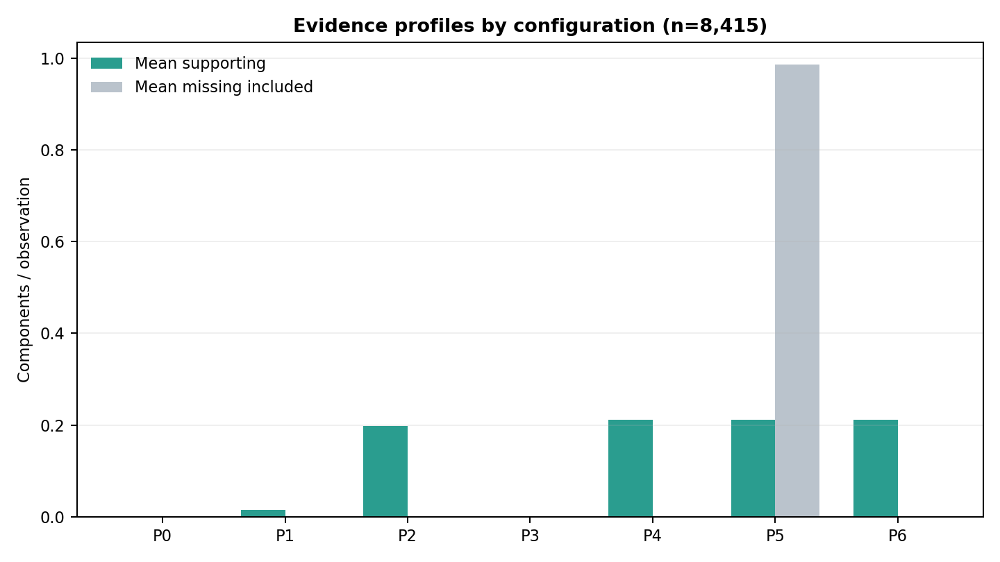
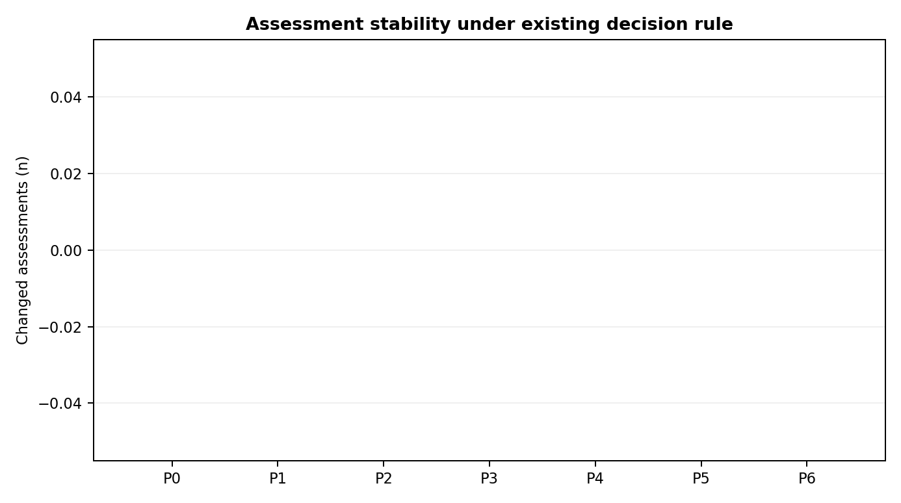
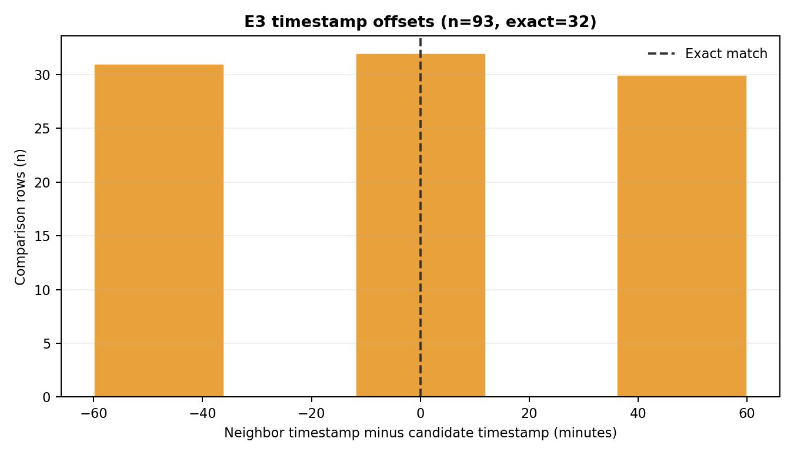

# Phase 12 — Evidence Contribution, Dependency and Sensitivity Analysis

Run: 20261119T142659Z  
Observations: 8,415 identical held-out timestamps  
Period: 2025-03-21 23:30:00+05:30 to 2026-03-09 23:30:00+05:30  
Scope: saved artifacts only; no model retraining, threshold tuning, or external data.

## Method

Loaded integrity-verified Phase 01 data and Phase 03 predictions, then ran the existing adapters on the exact saved timestamps. Ablations preserve baseline predictions and mask evidence only. E3 remained decision-ineligible. Historical input hashes were checked before and after; unchanged: True.

Paired binary contingency, agreement, Jaccard and phi summarize matched indicators. Jaccard is undefined when the positive union is empty; phi is undefined for constant marginals. These statistics describe association, not causation or independence. Accuracy, precision, recall and F1 are unavailable without independent adjudicated labels.

## Evidence coverage

| Component | Available | Descriptive only | Missing / insufficient | Supporting |
|---|---:|---:|---:|---:|
| E1 | 8415 | 0 | 0 | 123 |
| E2 | 8415 | 0 | 0 | 1661 |
| E3 | 0 | 123 | 8292 | 0 |
| E4 | 8415 | 0 | 0 | 0 |

## E1 dependency

Baseline and E1 vote counts were identical for 8,415/8,415 observations; candidate flags matched for 8,415/8,415. E1 summarizes the same 12 saved labels and same 8/12 screen. No additional independent input is identified. Removing its evidence record while preserving baseline necessarily retains that signal.

## E2 and E4

E2 exposes prior-history temporal screening; E4 exposes broad physical, missingness, and cross-variable screens. These can change evidence profiles and explanations without changing category. Both use processed primary-station data and are not independent calibrated reliability estimates.

| Left | Right | Both positive | Left only | Right only | Agreement % | Jaccard | Phi |
|---|---|---:|---:|---:|---:|---:|---:|
| E1 | E2 | 47 | 76 | 1614 | 79.91681521093285 | 0.027058146229130685 | 0.056525561345238465 |
| E1 | E4 | 0 | 123 | 0 | 98.53832442067736 | 0.0 | undefined |
| E2 | E4 | 0 | 1661 | 0 | 80.26143790849673 | 0.0 | undefined |

## Sensitivity

| ID | Configuration | Category changes vs P0 | Evidence profile changes | Explanation changes | Mean available | Mean supporting | Mean missing |
|---|---|---:|---:|---:|---:|---:|---:|
| P0 | Baseline only | 0 | 0 | 0 | 0.000 | 0.000 | 0.000 |
| P1 | Baseline + E1 | 0 | 8415 | 8415 | 1.000 | 0.015 | 0.000 |
| P2 | Baseline + E2 | 0 | 8415 | 8415 | 1.000 | 0.197 | 0.000 |
| P3 | Baseline + E4 | 0 | 8415 | 8415 | 1.000 | 0.000 | 0.000 |
| P4 | Baseline + E1 + E2 + E4 | 0 | 8415 | 8415 | 3.000 | 0.212 | 0.000 |
| P5 | Full E1-E4 with descriptive E3 | 0 | 8415 | 8415 | 3.000 | 0.212 | 0.985 |
| P6 | E1 + E2 + E4 without E3 | 0 | 8415 | 8415 | 3.000 | 0.212 | 0.000 |

Zero category changes follow from the current rule: category comes from the unchanged baseline candidate screen; E2/E4 do not vote and E3 cannot affect decisions. Category stability does not mean evidence-profile stability.

## E3 descriptive spatial context

E3 had descriptive comparisons for 123 observations and insufficient evidence for 8,292. There were 246 candidate-indexed neighbor rows: 32 exact timestamps, 61 nonzero offsets, 153 missing offsets; median absolute offset 60.0 minutes. Neighbor IDs: 42099, 42101. Independent lineage verified: False. Candidate indexing is not proof of alignment or independent corroboration.

Variable-wise valid pair counts, mean differences, absolute differences, and RMSE are in phase12_e3_pairwise_measurements.csv. Asynchronous comparisons remain descriptive.

## Research conclusions

1. E1 supplies no independently identified input beyond the saved baseline vote; its information is composition/explanation of the same signal.
2. E2 contributes temporal screening output, but its incremental predictive validity is untested.
3. E4 contributes broad physical screening and missingness information, not a fault/event diagnosis.
4. E2/E4 paired association is listed above; shared processed inputs mean independence is unsupported.
5. Zero decision changes are explained by baseline-only categorization and E3 decision-ineligibility.
6. The integration records components but the final category hides additive evidence profile. This analysis quantifies profiles without changing the engine.
7. E3 adds candidate-indexed descriptive comparisons only; no independent corroboration is validated.
8. Independent labels, station lineage and calibrated thresholds are missing, preventing predictive-performance claims.
9. Next: acquire provenance-verified independent station data, pre-register event adjudication, and evaluate incremental value on independent events/stations.

Limitations: E2/E4 are exploratory; E3 identity, lineage and timestamp alignment are unresolved. ANOMALY ≠ FAULT; missing evidence is not normal evidence.

Re-run using python scripts/run_phase12_analysis.py. Outputs: phase12_observation_level_results.csv, phase12_component_dependency.csv, phase12_component_overlap.csv, phase12_evidence_coverage.csv, phase12_sensitivity_results.csv, phase12_e3_descriptive_results.csv, phase12_e3_pairwise_measurements.csv, phase12_summary.json, and eight PNG figures in this timestamped output directory.
