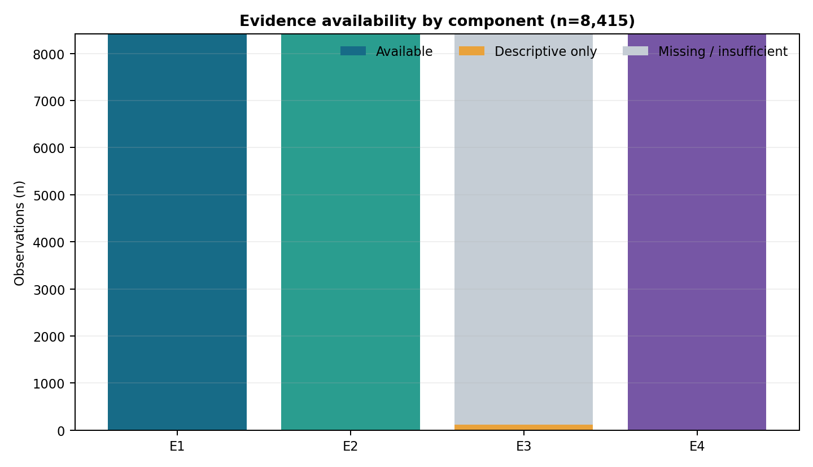
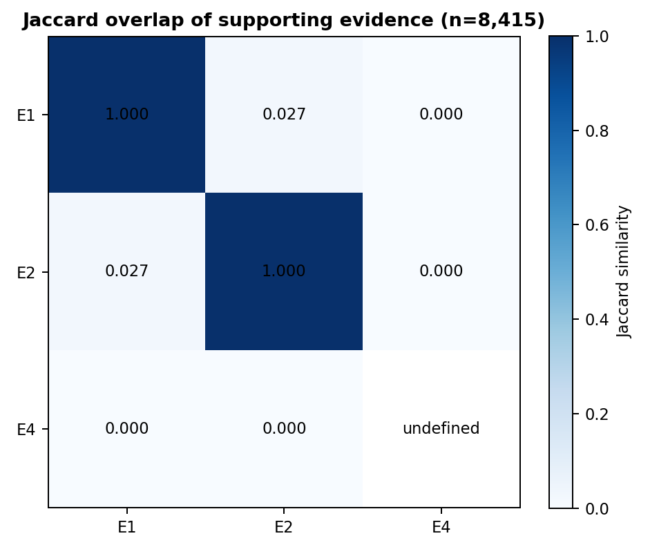
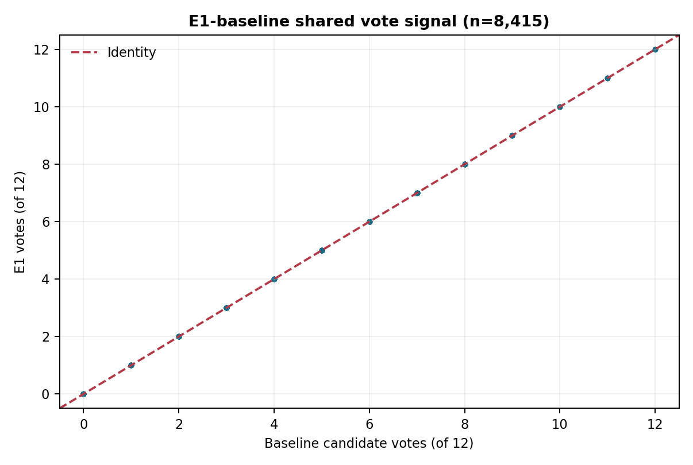
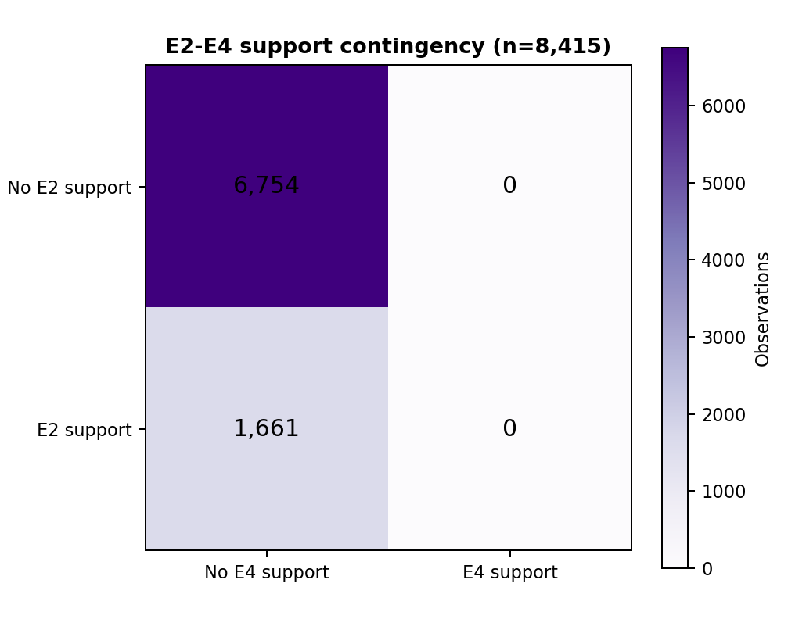
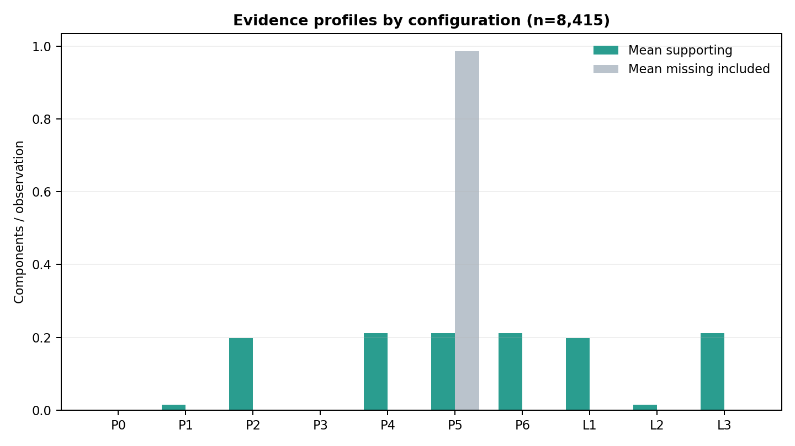
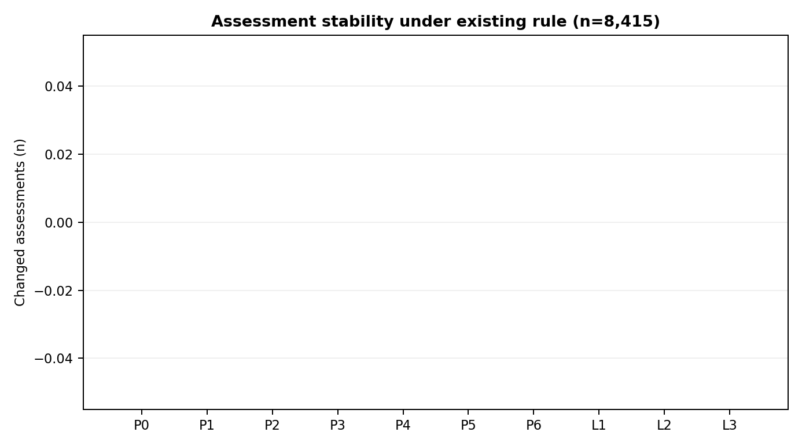
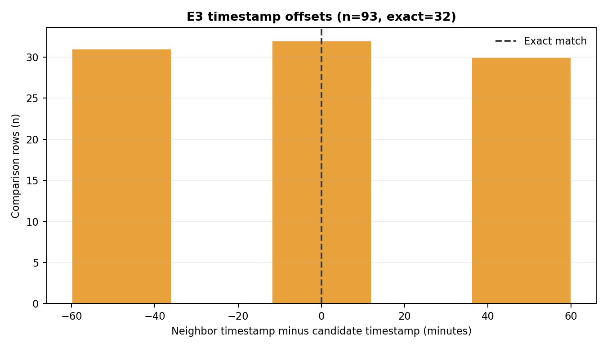
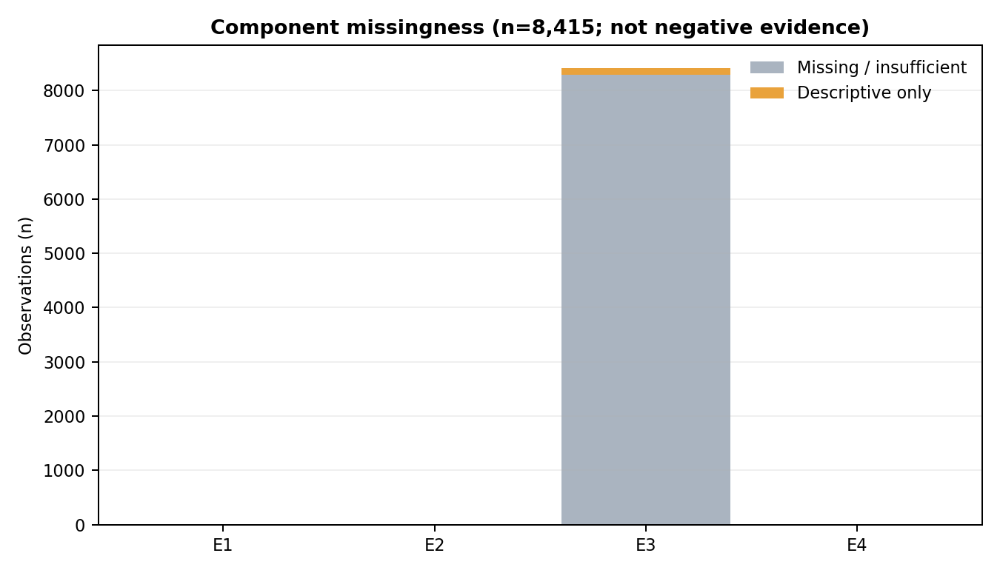

# WeatherGuard AI: Phase 13 Final Research Synthesis

**Research title:** *Uncertainty-Aware Event-Level Verification of Weather Station Anomalies Using Model Stability, Temporal Consistency and Spatial Evidence*  
**Evidence cut-off:** 2026-11-19  
**Authoritative component analysis:** `research_results/phase12_evidence_contribution/20261119T144632Z/`  
**Scope:** Synthesis of existing artifacts from Phases 01–12. No model was trained, no external observations were downloaded, and no decision threshold or application behavior was changed.

## Executive synthesis

WeatherGuard AI is best characterized as a research prototype for conservative, provenance-aware review of unusual weather-station readings. It combines a saved unsupervised-model consensus screen (E1), a prior-history temporal screen (E2), a spatial comparison component (E3), and broad physical/data-quality checks (E4). The governing distinction is **ANOMALY ≠ FAULT**: a statistical or physical screening flag is a reason to investigate, not a confirmed sensor malfunction.

The most defensible empirical finding is about the current evidence pipeline, rather than detection quality. On the saved 8,415-timestamp held-out window, Phase 12 established that E1 reproduces the baseline's saved model vote counts and 8/12 candidate flags at every timestamp. Thus the current E1 integration adds no identified independent signal. E2 generated 1,661 temporal support flags; the association with E1 was 79.9168% agreement, Jaccard 0.0271, and phi 0.0565. These are descriptive paired-indicator statistics on shared processed station data, not predictive validation. E4 generated no support flags and observed no missing input values in that window. E3 yielded zero decision-eligible independent observations; candidate-indexed comparisons remain descriptive or insufficient.

The model grid has 100,980 saved cells, but 42 cells disagree in a parity investigation, all associated with Isolation Forest. The cause remains unresolved. Synthetic injection work covers five selected contexts and eight scripted scenarios (160 context × scenario × injection-time units); it is useful as controlled software stress testing, not as field accuracy evidence. Across Phases 07–11, report lineage, independent station observations, original provider identifiers, and event adjudication remained insufficient for event-level validation.

Accordingly, the project does **not** establish anomaly-detection accuracy, fault-detection accuracy, E3 validation, or improved predictive performance from combining E1–E4. It supports a bounded software/method contribution: explicit evidence provenance and missingness states, separation of screening from fault diagnosis, and auditing of component dependency before interpreting a multi-evidence system.

## Research questions and answers

| Research question | Evidence-based answer |
|---|---|
| Does model stability provide an additional independent signal beyond the saved baseline? | No additional input is identified in the current artifacts. E1 vote counts and candidate flags equal baseline at 8,415/8,415 timestamps. |
| Does temporal consistency change what is surfaced for review? | It generates a distinct descriptive screen (1,661/8,415 support flags), but its validity against independent events is unknown. |
| Does spatial corroboration validate candidate events? | No. Strict lineage gates found no eligible independent pairs in Phase 06; Phase 09 found zero eligible candidate events; Phase 12 E3 remains decision-ineligible. |
| Do broad physical checks corroborate current candidate readings? | No positive E4 support was generated in the Phase 12 window. This does not establish that the readings are fault-free or that E4 lacks utility. |
| Does the integrated E1–E4 system classify faults accurately? | Unknown. No independent adjudicated event/fault labels exist, so predictive performance cannot be measured. |
| Are the saved model results exactly reproducible? | Not yet: 42 of 100,980 prediction cells differ in the parity investigation; all are Isolation Forest and the cause is unresolved. |

## Evidence base and dataset

Phase 01's integrity manifest records 44,879 processed observations and 44,849 feature-ready rows with nine persisted base features: temperature, dew point, relative humidity, precipitation, wind speed, pressure, and three temperature-history features. The temporal split contains 36,434 training rows and 8,415 test rows with a seven-day gap. Test timestamps span 2025-03-21 23:30 to 2026-03-09 23:30 (+05:30). Manifest hashes establish integrity of those files; they do not establish original provider lineage or sensor-level provenance.

The saved baseline comprises 12 configurations: four Isolation Forest contamination settings, four Local Outlier Factor neighbor settings, and four One-Class SVM nu settings. The prediction grid therefore contains 12 × 8,415 = 100,980 configuration-time cells. Existing E1 threshold counts are 432, 214, 123, 51, and 15 for 4/12, 6/12, 8/12, 10/12, and 12/12 respectively. They are candidate counts, not calibrated probabilities or measured accuracy. An earlier ablation document lists 36,464 training rows; this conflicts with the Phase 01 manifest and is treated as a documentation error. The manifest's 36,434 is used here.

## Framework synthesis

**E1 — Model/configuration stability.** E1 summarizes agreement across the same 12 saved model-configuration labels used by the baseline screen. In Phase 12, vote counts and 8/12 candidate flags match exactly at every test timestamp. E1 therefore functions as a description of baseline stability, not an independent evidence source in this implementation.

**E2 — Temporal consistency.** The implemented temporal screen uses prior primary-station history to flag selected temporal patterns. It does not consume E1 votes. It generated 1,661 supporting indicators in the held-out window. These flags indicate reviewable temporal behavior; threshold calibration and event-level validity are not established.

**E3 — Spatial corroboration.** E3 compares primary and neighboring station records, but evidence quality depends on station identity, source/report lineage, timestamp alignment, QC, and variable-level comparability. The Phase 04–11 progression narrowed provenance questions but did not produce independent, adjudicated candidate-event pairs. Phase 12's E3 is a descriptive adapter over earlier Phase 03 comparison tables, not a replacement for the controlled Phase 06 source-level analysis. E3 is isolated from classifier voting and decision-ineligible.

**E4 — Physical plausibility and data checks.** E4 applies broad range, cross-variable consistency, and missing-data checks. It is a screening layer, not station-specific sensor calibration or a fault classifier. No E4 support flags or missing measured values were found in the evaluated Phase 12 window.

The current assessment category remains baseline-derived: 123 timestamps are `SUSPICIOUS` under the existing 8/12 screen and 8,292 are `INSUFFICIENT_EVIDENCE`. No timestamp is labeled `NORMAL` or `ANOMALOUS`. E2/E4 change evidence descriptions; E3 cannot affect decisions. Zero category changes across Phase 12 ablations are therefore a consequence of the current policy, not proof of equivalent evidence profiles.

## Experimental findings

### Saved-data contribution and dependence analysis

The Phase 12 paired comparison covers identical 8,415 timestamps. E1 and baseline are identical by construction in the saved data. E1/E2 support flags overlap on 47 timestamps; E1-only is 76 and E2-only is 1,614, with 6,678 negative under both screens. Their high raw agreement is driven largely by jointly negative cases; the positive Jaccard and phi are small. E4 has a constant-zero support vector, so phi is undefined. These summaries describe indicators and must not be read as independent evidence, causal effects, or classification metrics.

Phase 12's evidence coverage and profile figures are reproduced in this package. The figure source register records each source image and its evidentiary scope. **Figure 1** summarizes component coverage; **Figure 2** shows supporting-indicator overlap; **Figure 3** exposes exact E1/baseline dependency; **Figure 4** shows E2/E4 paired agreement; **Figure 5** summarizes evidence profiles; **Figure 6** shows category stability under the fixed baseline-derived category rule; **Figure 7** shows E3 time-offset classes; and **Figure 8** shows missingness/availability. These are Phase 12 outputs, not newly generated measurements.

### Synthetic stress tests

The synthetic campaign evaluates five preselected contexts against eight scripted scenarios, giving 40 context-scenario combinations and 160 injected context × scenario × timestamp units. In the corrected baseline review, the 8/12 E1 response ranges by scenario from 0 to 100%, with substantial scenario differences. The E2 review contains 2,880 setting-level paired rows (160 underlying pair identifiers repeated across 18 settings); 1,008 rows changed status and 270 missing-block cases became unavailable. The unit of analysis is not the setting-level row. These outcomes are synthetic responses to injected patterns and do not estimate real-world sensitivity, specificity, false-alarm rate, or fault recall. The coverage-only ablation yielded 160/160 covered for E1 and E1+E4, 145/160 for E1+E2 and E1+E2+E4, and 0/160 for combinations requiring eligible E3. This is coverage, not decision utility.

## Provenance and E3 chronology

Phase 04 used Meteostat 2.2.3 with model filling and cleaning disabled and retained source labels, but its returned rows are not original provider payloads. Phase 05 resolved a station-record/airport-record relationship for VILD0, not exact sensor location or instrument history. Phase 06's strict lineage gate returned zero independent pairs. Phase 07 distinguished report systems at a limited report level while explicitly not establishing instrument or operator independence. Phase 08 produced an evidence policy, not empirical validation. Phase 09 found zero candidate events eligible for event-level validation. Phases 10 and 11 did not establish original provider IDs or adjudicated event truth; all reviewed events remained not adjudicated. Phase 12 continues this outcome: E3 has zero decision-eligible observations.

Phase 07's limited report-level evidence and Phases 09–11's insufficient event-level evidence are compatible because they answer different questions. A report-system distinction or a nearby archive copy does not provide independently sourced, time-matched, quality-screened event truth.

## Related research and contribution

The project's reference library is a focused narrative set of five meteorological QA/QC papers. It motivates variable-specific physical checks, temporal/spatial context, station metadata, and process-aware quality assurance [1]–[5]. It is not a systematic literature review, and these sources do not validate WeatherGuard's model settings or thresholds. No novelty claim is made from this limited corpus.

The defensible contribution is a reproducible evidence-audit workflow that makes signal reuse, provenance, missingness, time alignment, and decision eligibility explicit in a weather-station anomaly review system. The project also documents why output from an unsupervised screen cannot be equated with sensor failure. This is a software and evaluation-method contribution; the available experiments do not establish a novel or validated fault-detection algorithm.

## Readiness and safe reporting

The project is ready for a carefully bounded academic manuscript presenting system design, dataset handling, audit methodology, descriptive evidence contribution, synthetic stress testing, and limitations. It is not ready to claim validated event-level detection, fault diagnosis, E3 corroboration, component independence, or operational performance. The existing IEEE paper predates Phase 12 and must be revised so its findings, figures, and claims reflect this synthesis before submission.

Safe claims are listed in `PHASE13_SCIENTIFIC_CLAIMS.csv`, with source artifacts and strength. Numerical records and verification scopes are in `PHASE13_EXPERIMENTAL_RESULTS.csv`; phase-to-artifact mapping is in `PHASE13_PHASE_TRACEABILITY.csv`. Ranked gaps and next work are in `PHASE13_LIMITATIONS_AND_FUTURE_WORK.md`.

## References

[1] C. A. Fiebrich, C. R. Morgan, A. G. McCombs, P. K. Hall, and R. A. McPherson, “Quality Assurance Procedures for Mesoscale Meteorological Data,” *Journal of Atmospheric and Oceanic Technology*, vol. 27, no. 10, pp. 1565–1582, 2010, doi: 10.1175/2010JTECHA1433.1.

[2] J. Estévez, P. Gavilán, and J. V. Giráldez, “Guidelines on validation procedures for meteorological data from automatic weather stations,” *Journal of Hydrology*, vol. 402, nos. 1–2, pp. 144–154, 2011, doi: 10.1016/j.jhydrol.2011.02.031.

[3] C. A. Fiebrich *et al*., “Toward the Standardization of Mesoscale Meteorological Networks,” *Journal of Atmospheric and Oceanic Technology*, vol. 37, no. 11, pp. 2033–2049, 2020, doi: 10.1175/JTECH-D-20-0078.1.

[4] B. Faybishenko *et al*., “Challenging problems of quality assurance and quality control (QA/QC) of meteorological time series data,” *Stochastic Environmental Research and Risk Assessment*, vol. 36, pp. 1049–1062, 2022, doi: 10.1007/s00477-021-02106-w.

[5] M. Stawowy, W. Olchowik, A. Rosiński, and T. Dąbrowski, “The Analysis and Modelling of the Quality of Information Acquired from Weather Station Sensors,” *Remote Sensing*, vol. 13, no. 4, Art. no. 693, 2021, doi: 10.3390/rs13040693.
